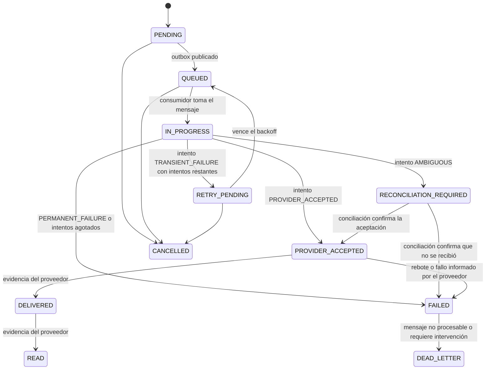

# ADR-0012: Semántica de entrega

- Estado: Aprobado (ampliado el 2026-11-15 con la máquina de estados de PD-02)
- Decisión: persistencia transaccional + Outbox + consumo al menos una vez; idempotencia en el servicio y deduplicación de webhooks.
- No prometer exactly-once extremo a extremo.
- En timeout ambiguo consultar estado externo cuando sea posible y evitar reenvío ciego.

## Ampliación 2026-11-15 — Máquina de estados de tres niveles (PD-02, aprobada)

### Contexto

El flujo único `ACCEPTED → QUEUED → PROCESSING → SENT → DELIVERED → READ` de [rabbitmq-outbox.md](../messaging/rabbitmq-outbox.md) no tenía forma de representar el resultado ambiguo exigido por esta misma ADR. [provider-contracts-v1.5.md](../providers/provider-contracts-v1.5.md) lo nombraba `UNKNOWN/RECONCILIATION_REQUIRED`. Ese flujo único queda **sustituido** por los tres niveles siguientes. Historial: [PENDING-DECISIONS.md, PD-02](../project/PENDING-DECISIONS.md#pd-02-máquina-de-estados-de-notificación-entrega-e-intento).

### Decisión vigente

**1. Resultado de intento** (`notification_attempts.result_code`). Una fila inmutable por cada ejecución individual contra el proveedor:

| Valor | Significado | Consecuencia |
|---|---|---|
| `PROVIDER_ACCEPTED` | El proveedor aceptó la solicitud | La entrega pasa a `PROVIDER_ACCEPTED` |
| `TRANSIENT_FAILURE` | Error recuperable (timeout antes de enviar, 5xx, 429 del proveedor) | Reintento con backoff exponencial, jitter y límite de intentos, respetando `Retry-After` |
| `PERMANENT_FAILURE` | Error no recuperable (destinatario o credencial inválidos) | Sin reintento automático |
| `AMBIGUOUS` | No se sabe con certeza si la operación externa tuvo efecto (timeout o caída después de enviar) | La entrega pasa a `RECONCILIATION_REQUIRED`; **nunca** reenvío ciego |

**2. Estado de entrega** (`notification_deliveries.status`). Ciclo técnico frente al proveedor:

`PENDING`, `QUEUED`, `IN_PROGRESS`, `PROVIDER_ACCEPTED`, `RETRY_PENDING`, `RECONCILIATION_REQUIRED`, `DELIVERED`, `READ`, `FAILED`, `DEAD_LETTER`, `CANCELLED`.

Reglas:

- `RECONCILIATION_REQUIRED` **no** genera reintento automático. La conciliación consulta al proveedor cuando su contrato lo permite y confirma la aceptación o la no recepción.
- Los reenvíos manuales requieren autorización y quedan auditados. Nunca son automáticos ni reutilizan en silencio un intento ambiguo. El mecanismo concreto (nuevo intento sobre la misma entrega o nueva entrega) y su efecto en la cuota no están definidos por esta decisión. Siguen abiertos en TP-19 ([technical-pending-register.md](../operations/technical-pending-register.md)).
- `PROVIDER_ACCEPTED` (público: `SENT`) significa que el proveedor aceptó el mensaje, no que se entregó.
- `DELIVERED` y `READ` solo se registran con evidencia del proveedor y según sus capacidades declaradas. No todos los proveedores las ofrecen (ver la tabla de capacidades en [provider-adapters.md](../providers/provider-adapters.md)).
- Los reintentos técnicos no consumen cuota adicional.

**3. Estado público de notificación** (`notifications.status`, expuesto en la API). Resumen derivado de la entrega vigente de la notificación (en v1, una entrega por canal/destinatario):

| Estado de entrega | Estado público |
|---|---|
| `PENDING` | `ACCEPTED` |
| `QUEUED`, `RETRY_PENDING` | `QUEUED` |
| `IN_PROGRESS`, `RECONCILIATION_REQUIRED` | `PROCESSING` |
| `PROVIDER_ACCEPTED` | `SENT` |
| `DELIVERED` | `DELIVERED` |
| `READ` | `READ` |
| `FAILED`, `DEAD_LETTER` | `FAILED` |
| `CANCELLED` | `CANCELLED` |

`RECONCILIATION_REQUIRED` **no** se expone como estado público: el cliente observa `PROCESSING` mientras dura la conciliación.

**4. Historiales.** `notification_status_history` registra los cambios del estado público. `delivery_status_history` registra cada transición de la entrega, con actor y `reason_code` ([erd.md](../data/erd.md)).

### Consecuencias

- El ERD, OpenAPI (`NotificationPublicStatus`), [rabbitmq-outbox.md](../messaging/rabbitmq-outbox.md) y los contratos de proveedores usan exclusivamente estos nombres.
- El término `UNKNOWN` queda retirado como estado. El resultado ambiguo se llama `AMBIGUOUS` en el intento y `RECONCILIATION_REQUIRED` en la entrega.
- El plazo y la periodicidad de la conciliación por proveedor se fijarán al validar el contrato real de cada proveedor.
