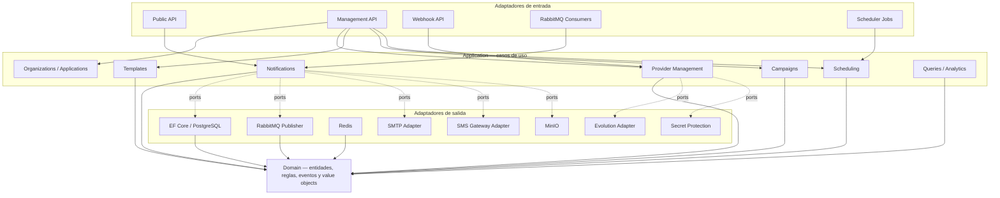

# C4 — Nivel 3: Componentes de backend

## Regla de dependencias

- `Domain` no referencia proyectos externos ni frameworks de infraestructura.
- `Application` referencia `Domain` y define los puertos requeridos.
- `Infrastructure` implementa los puertos definidos por Application (y usa Domain).
- `Api`, `Worker` y `Scheduler` son composition roots y adaptadores de entrada.
- Los controladores/endpoints no contienen reglas de negocio.
- No devolver entidades EF ni entidades de dominio directamente desde la API.
