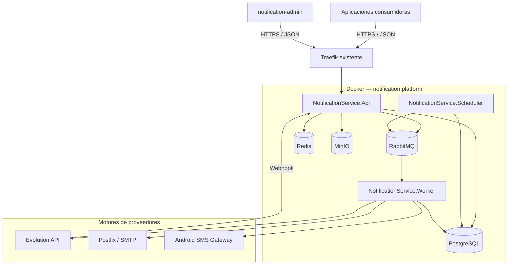

# C4 — Nivel 2: Contenedores

## Contenedores y responsabilidad

| Contenedor | Responsabilidad | Escalado |
|---|---|---|
| `notification-api` | REST pública, management y webhooks | Horizontal |
| `notification-worker` | Consumir colas y despachar entregas | Horizontal por canal/concurrencia |
| `notification-scheduler` | Reclamar programaciones vencidas y crear eventos Outbox | Una instancia activa o liderazgo distribuido |
| `notification-admin` | UI React; vive en repositorio/Compose independiente | Horizontal/estático |
| PostgreSQL | Fuente de verdad transaccional | Vertical/HA según necesidad |
| RabbitMQ | Transporte asíncrono | Según capacidad |
| Redis | Caché, límites y datos efímeros | Según necesidad |
| MinIO | Objetos adjuntos | Según necesidad |
| Evolution / Postfix / SMS Gateway | Motores externos/adaptadores | Independiente |

## Redes

- `traefik`: red externa ya administrada; solo API y Admin se conectan a ella.
- `notification_internal`: red privada para API, Worker, Scheduler y dependencias.
- `notification_providers`: red privada para Workers y motores autohospedados.
- Los servicios de datos no publican puertos al host en producción.
- No usar `internal: true` en una red que necesite salida a proveedores externos; separar la red privada de datos de la red de egreso controlado.

## Separación de despliegue

El Compose del backend administra API, Worker, Scheduler y dependencias que sean propiedad de esta plataforma. Los motores Evolution/Postfix pueden tener Compose separado y compartir únicamente una red privada explícitamente creada. Traefik nunca se incorpora al Compose de esta solución.
