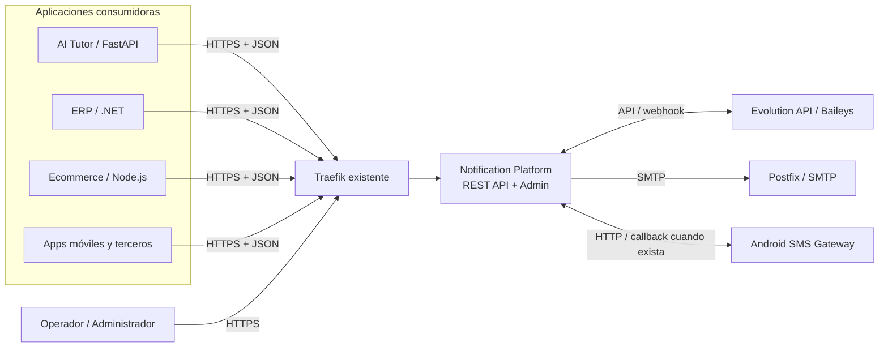

# C4 — Nivel 1: Contexto

## Propósito

`notification-service` ofrece capacidades centralizadas de envío y seguimiento de notificaciones a aplicaciones internas o externas, sin exigir que estas conozcan los proveedores ni la infraestructura.

## Actores y sistemas externos

| Actor/sistema | Interacción |
|---|---|
| Aplicación consumidora | Solicita envíos, consulta estados y adjunta archivos mediante REST/JSON |
| Administrador de plataforma | Gestiona organizaciones, aplicaciones, proveedores, plantillas y campañas mediante el panel |
| Evolution API | Motor autohospedado para WhatsApp Web/Baileys; conexión y eventos por API/webhook |
| Postfix/SMTP | Transporte de correo autohospedado |
| Android SMS Gateway | Puerta de enlace SMS conectada a dispositivo/SIM |
| Traefik | Proxy inverso y terminación TLS ya existente en el VPS |

## Diagrama

## Principios

1. La API pública es el producto principal; el panel no es una dependencia de ejecución.
2. Ninguna aplicación consumidora se conecta directamente a Evolution, Postfix o SMS Gateway.
3. La aceptación de una solicitud (`202 Accepted`) no equivale a entrega.
4. El servicio no promete entrega cuando el proveedor no ofrece confirmación.
5. Cada dato de negocio queda asociado a una organización y, cuando corresponda, a una aplicación.
