# Modelo entidad-relación definitivo — v1.5

**Estado:** modelo lógico propuesto para revisión técnica; no es una migración SQL ejecutada.

## Principios

- PostgreSQL es la fuente de verdad transaccional.
- Todas las entidades propiedad de una organización incluyen `organization_id` o quedan vinculadas mediante una relación cuya integridad impide cruces entre organizaciones.
- Las aplicaciones pertenecen a una sola organización.
- Los usuarios pueden pertenecer a varias organizaciones mediante `organization_memberships`; sus roles se asignan dentro de cada membresía.
- `super_admin` es un rol de plataforma separado del RBAC de organización.
- Los secretos se guardan cifrados o como referencias a un secret manager. Nunca se devuelven en APIs.
- JSONB se reserva para payloads/configuración variables; identidad, relaciones, estados y campos de búsqueda se normalizan.

## Diagrama lógico

```mermaid
erDiagram
  ORGANIZATIONS ||--o{ APPLICATIONS : owns
  USERS ||--o{ ORGANIZATION_MEMBERSHIPS : joins
  ORGANIZATIONS ||--o{ ORGANIZATION_MEMBERSHIPS : has
  ORGANIZATION_MEMBERSHIPS ||--o{ MEMBERSHIP_ROLES : receives
  ROLES ||--o{ MEMBERSHIP_ROLES : assigned
  ROLES ||--o{ ROLE_PERMISSIONS : grants
  PERMISSIONS ||--o{ ROLE_PERMISSIONS : included
  APPLICATIONS ||--o{ API_KEYS : authenticates
  APPLICATIONS ||--o{ APPLICATION_PERMISSIONS : grants
  ORGANIZATIONS ||--o{ PROVIDER_ACCOUNTS : configures
  PROVIDER_DEFINITIONS ||--o{ PROVIDER_ACCOUNTS : type
  PROVIDER_ACCOUNTS ||--o{ PROVIDER_CREDENTIALS : secures
  PROVIDER_ACCOUNTS ||--o{ PROVIDER_INSTANCES : manages
  PROVIDER_INSTANCES ||--o{ WHATSAPP_SENDERS : exposes
  PROVIDER_ACCOUNTS ||--o{ SMS_GATEWAYS : manages
  APPLICATIONS ||--o{ APPLICATION_SENDERS : authorizes
  WHATSAPP_SENDERS ||--o{ APPLICATION_SENDERS : assigned
  APPLICATIONS ||--o{ NOTIFICATIONS : submits
  ORGANIZATIONS ||--o{ NOTIFICATIONS : owns
  NOTIFICATIONS ||--o{ NOTIFICATION_DELIVERIES : routes
  NOTIFICATION_DELIVERIES ||--o{ NOTIFICATION_ATTEMPTS : attempts
  NOTIFICATIONS ||--o{ NOTIFICATION_EVENTS : emits
  NOTIFICATIONS ||--o{ NOTIFICATION_STATUS_HISTORY : changes
  NOTIFICATIONS ||--o{ ATTACHMENTS : references
  APPLICATIONS ||--o{ TEMPLATES : owns
  TEMPLATES ||--o{ TEMPLATE_VERSIONS : versions
  APPLICATIONS ||--o{ CAMPAIGNS : owns
  CAMPAIGNS ||--o{ CAMPAIGN_RECIPIENTS : contains
  NOTIFICATIONS ||--o| SCHEDULED_NOTIFICATIONS : schedules
  PROVIDER_ACCOUNTS ||--o{ WEBHOOK_EVENTS : receives
  APPLICATIONS ||--o{ IDEMPOTENCY_RECORDS : scopes
  ORGANIZATIONS ||--o{ QUOTA_USAGE : consumes
  ORGANIZATIONS ||--o{ OUTBOX_MESSAGES : publishes
  USERS ||--o{ REFRESH_TOKENS : owns
  ORGANIZATIONS ||--o{ AUDIT_LOGS : records
```

## Diccionario de entidades

### Identidad y tenancy

| Tabla | Campos esenciales | Reglas e índices |
|---|---|---|
| `organizations` | `id`, `code`, `name`, `status`, `timezone`, `created_at`, `updated_at` | `code` único; `timezone` IANA obligatorio; default de alta `America/Lima`. |
| `applications` | `id`, `organization_id`, `code`, `name`, `status`, `timezone_override` nullable, `created_at`, `updated_at` | UNIQUE (`organization_id`,`code`); FK compuesta para impedir cruces de tenant. |
| `users` | `id`, `email_normalized`, `password_hash`, `display_name`, `status`, timestamps | Email normalizado único global; no contiene `organization_id`. |
| `organization_memberships` | `id`, `organization_id`, `user_id`, `status`, `joined_at` | UNIQUE (`organization_id`,`user_id`); habilita un usuario en varias organizaciones. |
| `roles` | `id`, `organization_id` nullable, `code`, `name`, `is_system` | Roles globales del sistema y roles personalizados por organización. |
| `permissions` | `id`, `code`, `description` | Catálogo controlado por la plataforma. |
| `membership_roles` | `membership_id`, `role_id` | UNIQUE (`membership_id`,`role_id`); validar rol global o de la misma organización. |
| `role_permissions` | `role_id`, `permission_id` | UNIQUE (`role_id`,`permission_id`). |
| `refresh_tokens` | `id`, `user_id`, `token_hash`, `family_id`, `expires_at`, `used_at`, `revoked_at`, `created_at` | Guardar hash; rotación de un solo uso y detección de reutilización. |

### Aplicaciones y acceso máquina-a-máquina

| Tabla | Campos esenciales | Reglas e índices |
|---|---|---|
| `api_keys` | `id`, `application_id`, `key_prefix`, `key_hash`, `scopes_json`, `expires_at`, `revoked_at`, `last_used_at` | El secreto solo se muestra una vez; guardar hash con algoritmo adecuado y prefijo para localizar. |
| `application_permissions` | `application_id`, `permission_code` | UNIQUE (`application_id`,`permission_code`). |
| `application_limits` | `application_id`, `channel`, `daily_limit`, `rate_per_minute`, `updated_at` | Los límites solo pueden reducir el límite efectivo de organización, salvo política administrativa explícita. |

### Proveedores, conexiones y remitentes

| Tabla | Campos esenciales | Reglas e índices |
|---|---|---|
| `provider_definitions` | `id`, `code`, `channel`, `adapter_key`, `enabled` | Catálogo: `EVOLUTION_API`, `POSTFIX_SMTP`, `CUSTOM_SMTP`, `ANDROID_SMS_GATEWAY`; Meta queda futuro. |
| `provider_accounts` | `id`, `organization_id`, `provider_definition_id`, `code`, `name`, `status`, `configuration_json`, `is_default`, timestamps | UNIQUE (`organization_id`,`code`); configuración validada por adaptador. |
| `provider_credentials` | `id`, `provider_account_id`, `secret_reference` o `ciphertext`, `key_version`, `rotated_at` | No almacenar secretos en claro; clave maestra fuera de PostgreSQL. |
| `provider_instances` | `id`, `organization_id`, `provider_account_id`, `external_instance_id`, `connection_status`, `session_reference`, `last_connected_at`, `last_seen_at` | UNIQUE (`provider_account_id`,`external_instance_id`); una sesión por número. |
| `whatsapp_senders` | `id`, `organization_id`, `provider_account_id`, `provider_instance_id`, `display_number`, `normalized_number`, `label`, `status`, `is_default`, `connected_at`, `last_activity_at` | `normalized_number` acceso restringido; el número y la instancia deben pertenecer al mismo tenant. |
| `application_senders` | `application_id`, `sender_id`, `is_default`, `created_at` | PK/UNIQUE (`application_id`,`sender_id`); garantizar misma organización. Como máximo un default activo por aplicación/canal mediante índice parcial o validación transaccional. |
| `sms_gateways` | `id`, `organization_id`, `provider_account_id`, `device_label`, `device_identifier`, `sim_slot`, `status`, `last_seen_at` | Cada cliente aporta dispositivo/SIM; no guardar identificadores sensibles innecesarios. |
| `provider_health_checks` | `id`, `provider_account_id`, `status`, `latency_ms`, `checked_at`, `details_redacted` | Retención operativa limitada. |

### Notificaciones y entrega

| Tabla | Campos esenciales | Reglas e índices |
|---|---|---|
| `notifications` | `id`, `organization_id`, `application_id`, `channel`, `recipient_json`, `content_json`, `status`, `priority`, `scheduled_at`, `timezone_snapshot`, `correlation_id`, `created_at`, `accepted_at` | Inmutable en campos de identidad; índices (`organization_id`,`created_at`), (`application_id`,`created_at`), (`status`,`created_at`). |
| `notification_deliveries` | `id`, `notification_id`, `provider_account_id`, `sender_id` nullable, `status`, `provider_message_id`, `accepted_by_provider_at`, `sent_at`, `delivered_at`, `read_at` | Una o más entregas solo si el diseño de fallback/multi-destino lo permite; para v1 una entrega por canal/destinatario. |
| `notification_attempts` | `id`, `delivery_id`, `attempt_number`, `started_at`, `completed_at`, `result_code`, `error_code`, `error_detail_redacted`, `provider_request_id` | UNIQUE (`delivery_id`,`attempt_number`). Nunca almacenar tokens ni contenido sensible completo en errores. |
| `notification_events` | `id`, `notification_id`, `event_type`, `source`, `external_event_id`, `occurred_at`, `payload_redacted` | Eventos append-only; deduplicar por fuente y external ID cuando exista. |
| `notification_status_history` | `id`, `notification_id`, `previous_status`, `new_status`, `actor_type`, `actor_id`, `changed_at` | Append-only para auditoría de estado. |
| `idempotency_records` | `id`, `organization_id`, `application_id`, `idempotency_key`, `request_hash`, `resource_id`, `response_status`, `expires_at` | UNIQUE (`application_id`,`idempotency_key`); mismo key y hash devuelve recurso original; hash distinto produce 409. |

### Plantillas, adjuntos, campañas y programación

| Tabla | Campos esenciales | Reglas e índices |
|---|---|---|
| `templates` | `id`, `organization_id`, `application_id`, `code`, `name`, `channel`, `status`, timestamps | UNIQUE (`application_id`,`code`,`channel`). |
| `template_versions` | `id`, `template_id`, `version`, `locale`, `body`, `subject`, `schema_json`, `created_at` | UNIQUE (`template_id`,`version`,`locale`); versiones publicadas inmutables. |
| `attachments` | `id`, `organization_id`, `application_id`, `object_key`, `file_name`, `content_type`, `size_bytes`, `checksum_sha256`, `scan_status`, `created_at`, `expires_at` | Bucket privado; validar tamaño, MIME real y checksum. |
| `campaigns` | `id`, `organization_id`, `application_id`, `name`, `channel`, `template_version_id`, `status`, `scheduled_at`, `created_at` | Estados controlados; validar consentimiento y límites antes de iniciar. |
| `campaign_recipients` | `id`, `campaign_id`, `recipient_ref`, `recipient_json`, `status`, `notification_id`, `error_code` | No duplicar destinatario dentro de campaña según regla de negocio configurada. |
| `scheduled_notifications` | `id`, `notification_id`, `execute_at_utc`, `timezone`, `status`, `cancelled_at` | Índice (`status`,`execute_at_utc`); guardar zona horaria interpretada para auditoría. |

### Cuotas, webhooks y resiliencia

| Tabla | Campos esenciales | Reglas e índices |
|---|---|---|
| `quota_usage` | `id`, `organization_id`, `channel`, `period_start_utc`, `period_end_utc`, `accepted_count`, `updated_at` | Ventana diaria calculada en zona horaria de organización; actualización atómica. |
| `webhook_events` | `id`, `organization_id`, `provider_account_id`, `provider_event_id`, `event_type`, `received_at`, `processed_at`, `processing_status`, `payload_redacted` | Deduplicación por proveedor/cuenta/event ID; conservar raw payload solo con política de retención y protección. |
| `outbox_messages` | `id`, `organization_id`, `aggregate_type`, `aggregate_id`, `event_type`, `payload`, `occurred_at`, `published_at`, `attempts`, `next_attempt_at` | Publicación confiable desde transacción PostgreSQL. |
| `inbox_messages` | `id`, `consumer_name`, `message_id`, `received_at`, `processed_at` | UNIQUE (`consumer_name`,`message_id`). |
| `audit_logs` | `id`, `organization_id` nullable, `actor_type`, `actor_id`, `action`, `resource_type`, `resource_id`, `result`, `correlation_id`, `created_at`, `metadata_redacted` | Append-only; acceso restringido. |

## Reglas de integridad y aislamiento

1. `organization_id` se obtiene del principal autenticado y se valida en servidor; nunca se confía en un tenant enviado por el cliente.
2. Toda notificación valida que `application_id` pertenece a `organization_id`.
3. Toda asignación `application_senders` valida que aplicación y remitente pertenecen a la misma organización.
4. Cada instancia Evolution y su sesión son exclusivas de una organización y un número.
5. Se recomiendan claves foráneas compuestas (`organization_id`, `id`) en recursos tenant-owned para impedir referencias cruzadas.
6. PostgreSQL RLS puede añadirse como defensa adicional; el contexto debe establecerse por transacción y limpiarse al devolver conexiones al pool.
7. La cuota se reserva atómicamente al aceptar una solicitud; una repetición idempotente no incrementa el contador.
8. Los instantes se almacenan en UTC. `organizations.timezone` se utiliza para calcular periodos diarios; `applications.timezone_override` solo se permite si la política de producto lo habilita.
9. La eliminación de cuentas/proveedores debe ser lógica y auditable cuando existan notificaciones históricas asociadas.
10. Este modelo requiere revisión de índices, restricciones parciales y tipos exactos antes de generar migraciones EF Core.
