# Modelo entidad-relación — v1

**Estado:** **modelo lógico aprobado para v1** (2026-11-15), con las decisiones PD-01, PD-02 y PD-05 de [PENDING-DECISIONS.md](../project/PENDING-DECISIONS.md). No es SQL ni una migración: los tipos físicos, nombres de restricciones e índices definitivos se fijan al implementar la Fase 2, sin cambiar la semántica de este documento.

## Principios

- PostgreSQL es la fuente de verdad transaccional.
- Todas las entidades propiedad de una organización incluyen `organization_id` o quedan vinculadas mediante una relación cuya integridad impide cruces entre organizaciones.
- Las aplicaciones pertenecen a una sola organización y heredan su zona horaria (no hay zona horaria propia en v1).
- Los usuarios pueden pertenecer a varias organizaciones mediante `organization_memberships`; sus roles de organización se asignan dentro de cada membresía.
- `super_admin` es un **privilegio de plataforma** almacenado en `platform_role_assignments`, separado del RBAC de organización. No existe como fila de `roles` ni puede asignarse mediante `membership_roles`.
- Los estados se separan en tres niveles: público de notificación, entrega e intento ([ADR-0012](../adr/0012-delivery-semantics.md)).
- Los secretos se guardan cifrados o como referencias a un secret manager. Nunca se devuelven en APIs.
- JSONB se reserva para payloads/configuración variables; identidad, relaciones, estados y campos de búsqueda se normalizan.

## Diagrama lógico

```mermaid
erDiagram
  ORGANIZATIONS ||--o{ APPLICATIONS : owns
  USERS ||--o{ ORGANIZATION_MEMBERSHIPS : joins
  ORGANIZATIONS ||--o{ ORGANIZATION_MEMBERSHIPS : has
  ORGANIZATION_MEMBERSHIPS ||--o{ MEMBERSHIP_ROLES : receives
  ROLES ||--o{ MEMBERSHIP_ROLES : assigned
  ORGANIZATIONS |o--o{ ROLES : defines_custom
  ROLES ||--o{ ROLE_PERMISSIONS : grants
  PERMISSIONS ||--o{ ROLE_PERMISSIONS : included
  USERS ||--o{ PLATFORM_ROLE_ASSIGNMENTS : holds
  USERS |o--o{ PLATFORM_ROLE_ASSIGNMENTS : grants_or_revokes
  USERS ||--o{ REFRESH_TOKENS : owns
  APPLICATIONS ||--o{ API_KEYS : authenticates
  APPLICATIONS ||--o{ APPLICATION_PERMISSIONS : grants
  APPLICATIONS ||--o{ APPLICATION_LIMITS : limits
  ORGANIZATIONS ||--o{ PROVIDER_ACCOUNTS : configures
  PROVIDER_DEFINITIONS ||--o{ PROVIDER_ACCOUNTS : type
  PROVIDER_ACCOUNTS ||--o{ PROVIDER_CREDENTIALS : secures
  PROVIDER_ACCOUNTS ||--o{ PROVIDER_INSTANCES : manages
  PROVIDER_ACCOUNTS ||--o{ PROVIDER_HEALTH_CHECKS : monitors
  PROVIDER_INSTANCES ||--o{ WHATSAPP_SENDERS : exposes
  PROVIDER_ACCOUNTS ||--o{ SMS_GATEWAYS : manages
  APPLICATIONS ||--o{ APPLICATION_SENDERS : authorizes
  WHATSAPP_SENDERS ||--o{ APPLICATION_SENDERS : assigned
  ORGANIZATIONS ||--o{ NOTIFICATIONS : owns
  APPLICATIONS ||--o{ NOTIFICATIONS : submits
  NOTIFICATIONS ||--o{ NOTIFICATION_DELIVERIES : routes
  PROVIDER_ACCOUNTS ||--o{ NOTIFICATION_DELIVERIES : delivers
  WHATSAPP_SENDERS |o--o{ NOTIFICATION_DELIVERIES : sends
  NOTIFICATION_DELIVERIES ||--o{ NOTIFICATION_ATTEMPTS : attempts
  NOTIFICATION_DELIVERIES ||--o{ DELIVERY_STATUS_HISTORY : changes
  NOTIFICATIONS ||--o{ NOTIFICATION_EVENTS : emits
  NOTIFICATIONS ||--o{ NOTIFICATION_STATUS_HISTORY : changes
  NOTIFICATIONS ||--o{ ATTACHMENTS : references
  NOTIFICATIONS ||--o| SCHEDULED_NOTIFICATIONS : schedules
  APPLICATIONS ||--o{ TEMPLATES : owns
  TEMPLATES ||--o{ TEMPLATE_VERSIONS : versions
  APPLICATIONS ||--o{ CAMPAIGNS : owns
  TEMPLATE_VERSIONS ||--o{ CAMPAIGNS : uses
  CAMPAIGNS ||--o{ CAMPAIGN_RECIPIENTS : contains
  NOTIFICATIONS |o--o| CAMPAIGN_RECIPIENTS : generated_for
  APPLICATIONS ||--o{ IDEMPOTENCY_RECORDS : scopes
  ORGANIZATIONS ||--o{ QUOTA_USAGE : consumes
  PROVIDER_ACCOUNTS ||--o{ WEBHOOK_EVENTS : receives
  ORGANIZATIONS ||--o{ OUTBOX_MESSAGES : publishes
  ORGANIZATIONS |o--o{ AUDIT_LOGS : records
  INBOX_MESSAGES {
    uuid id PK
    string consumer_name
    string message_id
  }
```

## Relaciones

| Relación | Clave foránea | Explicación |
|---|---|---|
| Organización → aplicaciones | `applications.organization_id` | Cada aplicación pertenece a una sola organización |
| Usuario/organización → membresías | `organization_memberships.user_id`, `.organization_id` | Muchos a muchos usuario–organización |
| Membresía → roles | `membership_roles.membership_id`, `.role_id` | Roles de organización asignados dentro de una membresía |
| Organización → roles personalizados | `roles.organization_id` (nullable) | `NULL` = rol del sistema compartido; valor = rol personalizado de esa organización |
| Rol → permisos | `role_permissions.role_id`, `.permission_id` | Definición de permisos de cada rol |
| Usuario → privilegios de plataforma | `platform_role_assignments.user_id` | Asignación de `super_admin`, independiente de las membresías |
| Usuario → concesión/revocación | `platform_role_assignments.granted_by`, `.revoked_by` | Quién concedió o revocó el privilegio (auditoría) |
| Usuario → refresh tokens | `refresh_tokens.user_id` | Sesiones del panel |
| Aplicación → API Keys, permisos, límites | `api_keys.application_id`, `application_permissions.application_id`, `application_limits.application_id` | Acceso máquina a máquina y límites por aplicación |
| Organización → cuentas de proveedor | `provider_accounts.organization_id` | Cada cuenta pertenece a una organización |
| Definición → cuentas de proveedor | `provider_accounts.provider_definition_id` | Tipo de proveedor y adaptador |
| Cuenta → `provider_credentials`, `provider_instances`, `provider_health_checks`, `sms_gateways`, `webhook_events` | `*.provider_account_id` | Recursos técnicos de la cuenta de proveedor |
| Instancia → remitentes WhatsApp | `whatsapp_senders.provider_instance_id` | Un número por instancia/sesión |
| Aplicación/remitente → asignaciones | `application_senders.application_id`, `.sender_id` | Remitentes autorizados por aplicación (misma organización) |
| Organización/aplicación → notificaciones | `notifications.organization_id`, `.application_id` | Ámbito de tenant de cada notificación |
| Notificación → entregas | `notification_deliveries.notification_id` | En v1, una entrega por notificación |
| Cuenta/remitente → entregas | `notification_deliveries.provider_account_id`, `.sender_id` (nullable) | Proveedor y remitente resueltos para la entrega |
| Entrega → intentos | `notification_attempts.delivery_id` | Una fila por ejecución individual contra el proveedor |
| Entrega → historial de entrega | `delivery_status_history.delivery_id` | Transiciones del estado de entrega |
| Notificación → historial público | `notification_status_history.notification_id` | Transiciones del estado público |
| Notificación → eventos | `notification_events.notification_id` | Eventos internos y de proveedor (append-only) |
| Notificación → `attachments` | ver nota | El vínculo notificación–adjunto no está modelado como columna; pendiente (TP-18) |
| Notificación → programación | `scheduled_notifications.notification_id` | Como máximo una programación por notificación |
| Aplicación → plantillas → versiones | `templates.application_id`, `template_versions.template_id` | Versionado de plantillas |
| Aplicación/versión → campañas | `campaigns.application_id`, `.template_version_id` | Campaña ligada a una versión publicada |
| Campaña → destinatarios → notificación | `campaign_recipients.campaign_id`, `.notification_id` (nullable) | Cada destinatario genera como máximo una notificación |
| Aplicación → idempotencia | `idempotency_records.application_id` | Claves de idempotencia por aplicación |
| Organización → cuota, outbox, auditoría | `quota_usage.organization_id`, `outbox_messages.organization_id`, `audit_logs.organization_id` (nullable) | La auditoría global de plataforma usa `organization_id = NULL` |
| `inbox_messages` | — | Sin FK: deduplicación técnica por consumidor |

## Diccionario de entidades

### Identidad y tenancy

| Tabla | Campos esenciales | Reglas e índices |
|---|---|---|
| `organizations` | `id`, `code`, `name`, `status`, `timezone`, `created_at`, `updated_at` | `code` único; `timezone` IANA obligatorio; default de alta `America/Lima`. |
| `applications` | `id`, `organization_id`, `code`, `name`, `status`, `created_at`, `updated_at` | UNIQUE (`organization_id`,`code`); FK compuesta para impedir cruces de tenant. **Sin zona horaria propia en v1**: se usa `organizations.timezone` (PD-05). |
| `users` | `id`, `email_normalized`, `password_hash`, `display_name`, `status`, timestamps | Email normalizado único global; no contiene `organization_id`. |
| `organization_memberships` | `id`, `organization_id`, `user_id`, `status`, `joined_at` | UNIQUE (`organization_id`,`user_id`); habilita un usuario en varias organizaciones. |
| `roles` | `id`, `organization_id` nullable, `code`, `name`, `is_system` | **Definición** de roles de organización. `organization_id = NULL` solo para roles del sistema (`is_system = true`): `organization_admin`, `operator`, `viewer`. Con `organization_id` = rol personalizado de esa organización. UNIQUE (`organization_id`,`code`) más unicidad de `code` entre roles del sistema (índice parcial). CHECK `code <> 'super_admin'`. |
| `permissions` | `id`, `code`, `description` | Catálogo controlado por la plataforma. |
| `membership_roles` | `membership_id`, `role_id` | **Asignación** de rol de organización. UNIQUE (`membership_id`,`role_id`). El rol debe ser del sistema o de la misma organización que la membresía (validación transaccional o FK compuesta). `super_admin` no es asignable aquí porque no existe en `roles`. |
| `role_permissions` | `role_id`, `permission_id` | UNIQUE (`role_id`,`permission_id`). |
| `platform_role_assignments` | `id`, `user_id`, `role_code`, `granted_by` nullable, `created_at`, `revoked_at` nullable, `revoked_by` nullable | **Asignación de privilegio de plataforma.** FK `user_id` → `users`; FK `granted_by`/`revoked_by` → `users` (`granted_by` nullable solo para el alta inicial controlada). CHECK `role_code IN ('super_admin')`. UNIQUE parcial (`user_id`,`role_code`) WHERE `revoked_at IS NULL` (una asignación activa). Índice (`user_id`) WHERE `revoked_at IS NULL` para consultar asignaciones activas. Revocar = rellenar `revoked_at`/`revoked_by`, nunca borrar. Concesión y revocación generan `audit_logs`. |
| `refresh_tokens` | `id`, `user_id`, `token_hash`, `family_id`, `expires_at`, `used_at`, `revoked_at`, `created_at` | Guardar hash; rotación de un solo uso y detección de reutilización. |

### Aplicaciones y acceso máquina-a-máquina

| Tabla | Campos esenciales | Reglas e índices |
|---|---|---|
| `api_keys` | `id`, `application_id`, `key_prefix`, `key_hash`, `scopes_json`, `expires_at`, `revoked_at`, `last_used_at` | El secreto solo se muestra una vez; guardar hash con algoritmo adecuado y prefijo para localizar. Las API Keys no heredan roles humanos. |
| `application_permissions` | `application_id`, `permission_code` | UNIQUE (`application_id`,`permission_code`). |
| `application_limits` | `application_id`, `channel`, `daily_limit`, `rate_per_minute`, `updated_at` | Los límites solo pueden reducir el límite efectivo de organización (si no, `422 APPLICATION_LIMIT_EXCEEDS_ORGANIZATION_LIMIT`). La ventana diaria usa la zona horaria de la organización. |

### Proveedores, conexiones y remitentes

| Tabla | Campos esenciales | Reglas e índices |
|---|---|---|
| `provider_definitions` | `id`, `code`, `channel`, `adapter_key`, `enabled` | Catálogo: `EVOLUTION_API`, `POSTFIX_SMTP`, `CUSTOM_SMTP`, `ANDROID_SMS_GATEWAY`; Meta queda futuro. |
| `provider_accounts` | `id`, `organization_id`, `provider_definition_id`, `code`, `name`, `status`, `configuration_json`, `is_default`, timestamps | UNIQUE (`organization_id`,`code`); configuración validada por adaptador. |
| `provider_credentials` | `id`, `provider_account_id`, `secret_reference` o `ciphertext`, `key_version`, `rotated_at` | No almacenar secretos en claro; clave maestra fuera de PostgreSQL. |
| `provider_instances` | `id`, `organization_id`, `provider_account_id`, `external_instance_id`, `connection_status`, `session_reference`, `last_connected_at`, `last_seen_at` | UNIQUE (`provider_account_id`,`external_instance_id`); una sesión por número. |
| `whatsapp_senders` | `id`, `organization_id`, `provider_account_id`, `provider_instance_id`, `display_number`, `normalized_number`, `label`, `status`, `is_default`, `connected_at`, `last_activity_at` | `normalized_number` acceso restringido; el número y la instancia deben pertenecer al mismo tenant. |
| `application_senders` | `application_id`, `sender_id`, `is_default`, `created_at` | PK/UNIQUE (`application_id`,`sender_id`); garantizar misma organización. Como máximo un default activo por aplicación/canal mediante índice parcial o validación transaccional. |
| `sms_gateways` | `id`, `organization_id`, `provider_account_id`, `device_label`, `device_identifier`, `sim_slot`, `status`, `last_seen_at` | Cada cliente aporta dispositivo/SIM; no guardar identificadores sensibles innecesarios. |
| `provider_health_checks` | `id`, `provider_account_id`, `status`, `latency_ms`, `checked_at`, `details_redacted` | Retención operativa limitada. |

### Notificaciones, entregas, intentos e historiales

| Tabla | Campos esenciales | Reglas e índices |
|---|---|---|
| `notifications` | `id`, `organization_id`, `application_id`, `channel`, `recipient_json`, `content_json`, `status`, `priority`, `scheduled_at`, `timezone_snapshot`, `correlation_id`, `created_at`, `accepted_at` | `status` = **estado público** (CHECK con los valores de la tabla de estados), derivado de la entrega. `timezone_snapshot` = zona horaria de la organización vigente al aceptar o programar, para auditoría. Inmutable en campos de identidad. Índices (`organization_id`,`created_at`), (`application_id`,`created_at`), (`status`,`created_at`). |
| `notification_deliveries` | `id`, `notification_id`, `provider_account_id`, `sender_id` nullable, `status`, `provider_message_id`, `accepted_by_provider_at`, `sent_at`, `delivered_at`, `read_at` | `status` = **estado de entrega** (CHECK). Una o más entregas solo si el diseño de fallback/multi-destino lo permite; para v1, una entrega por canal/destinatario (que el reenvío manual cree una nueva entrega o un nuevo intento sigue abierto, TP-19). `delivered_at`/`read_at` solo con evidencia del proveedor. Índice (`status`) para conciliación y reintentos, y (`provider_account_id`,`provider_message_id`) para correlacionar webhooks. |
| `notification_attempts` | `id`, `delivery_id`, `attempt_number`, `started_at`, `completed_at`, `result_code`, `error_code`, `error_detail_redacted`, `provider_request_id` | Inmutable, una fila por ejecución. `result_code` = **resultado de intento** (CHECK: `PROVIDER_ACCEPTED`, `TRANSIENT_FAILURE`, `PERMANENT_FAILURE`, `AMBIGUOUS`); nullable solo mientras el intento está en curso. UNIQUE (`delivery_id`,`attempt_number`). Nunca almacenar tokens ni contenido sensible completo en errores. |
| `delivery_status_history` | `id`, `delivery_id`, `previous_status`, `new_status`, `actor_type`, `actor_id` nullable, `reason_code` nullable, `changed_at` | Append-only. FK `delivery_id` → `notification_deliveries`. `previous_status`/`new_status` con los valores del estado de entrega (`previous_status` nullable en la creación). `actor_type`: `SYSTEM`, `USER`, `API_KEY`, `PROVIDER`. `reason_code` explica la transición (p.ej. `PROVIDER_RESULT_AMBIGUOUS`, `RETRY_LIMIT_REACHED`, `MANUAL_RESEND`). Índice (`delivery_id`,`changed_at`). |
| `notification_status_history` | `id`, `notification_id`, `previous_status`, `new_status`, `actor_type`, `actor_id`, `changed_at` | Append-only; solo cambios del **estado público**. Índice (`notification_id`,`changed_at`). |
| `notification_events` | `id`, `notification_id`, `event_type`, `source`, `external_event_id`, `occurred_at`, `payload_redacted` | Eventos append-only (internos y de proveedor normalizados); deduplicar por fuente y external ID cuando exista. No sustituyen a los historiales de estado. |
| `idempotency_records` | `id`, `organization_id`, `application_id`, `idempotency_key`, `request_hash`, `resource_id`, `response_status`, `expires_at` | UNIQUE (`application_id`,`idempotency_key`); mismo key y hash devuelve recurso original; hash distinto produce `409 IDEMPOTENCY_KEY_CONFLICT`. |

### Plantillas, adjuntos, campañas y programación

| Tabla | Campos esenciales | Reglas e índices |
|---|---|---|
| `templates` | `id`, `organization_id`, `application_id`, `code`, `name`, `channel`, `status`, timestamps | UNIQUE (`application_id`,`code`,`channel`). |
| `template_versions` | `id`, `template_id`, `version`, `locale`, `body`, `subject`, `schema_json`, `created_at` | UNIQUE (`template_id`,`version`,`locale`); versiones publicadas inmutables. |
| `attachments` | `id`, `organization_id`, `application_id`, `object_key`, `file_name`, `content_type`, `size_bytes`, `checksum_sha256`, `scan_status`, `created_at`, `expires_at` | Bucket privado; validar tamaño, MIME real y checksum. |
| `campaigns` | `id`, `organization_id`, `application_id`, `name`, `channel`, `template_version_id`, `status`, `scheduled_at`, `created_at` | Estados controlados; validar consentimiento y límites antes de iniciar. |
| `campaign_recipients` | `id`, `campaign_id`, `recipient_ref`, `recipient_json`, `status`, `notification_id`, `error_code` | No duplicar destinatario dentro de campaña según regla de negocio configurada. |
| `scheduled_notifications` | `id`, `notification_id`, `execute_at_utc`, `timezone`, `status`, `cancelled_at` | Índice (`status`,`execute_at_utc`). `timezone` = zona horaria de la **organización** usada para interpretar la hora local, guardada para auditoría. |

### Cuotas, webhooks y resiliencia

| Tabla | Campos esenciales | Reglas e índices |
|---|---|---|
| `quota_usage` | `id`, `organization_id`, `channel`, `period_start_utc`, `period_end_utc`, `accepted_count`, `updated_at` | Ventana diaria calculada **siempre** en `organizations.timezone` (reinicio a las 00:00 locales); actualización atómica. UNIQUE (`organization_id`,`channel`,`period_start_utc`). |
| `webhook_events` | `id`, `organization_id`, `provider_account_id`, `provider_event_id`, `event_type`, `received_at`, `processed_at`, `processing_status`, `payload_redacted` | Deduplicación por proveedor/cuenta/event ID; conservar raw payload solo con política de retención y protección. |
| `outbox_messages` | `id`, `organization_id`, `aggregate_type`, `aggregate_id`, `event_type`, `payload`, `occurred_at`, `published_at`, `attempts`, `next_attempt_at` | Publicación confiable desde transacción PostgreSQL. |
| `inbox_messages` | `id`, `consumer_name`, `message_id`, `received_at`, `processed_at` | UNIQUE (`consumer_name`,`message_id`). |
| `audit_logs` | `id`, `organization_id` nullable, `actor_type`, `actor_id`, `action`, `resource_type`, `resource_id`, `result`, `correlation_id`, `created_at`, `metadata_redacted` | Append-only; acceso restringido. Registra, entre otros, la concesión y revocación de `super_admin` y los reenvíos manuales. |

## Estados (PD-02)

Definición completa y transiciones en [ADR-0012](../adr/0012-delivery-semantics.md).

| Columna | Valores |
|---|---|
| `notifications.status` (público) | `ACCEPTED`, `QUEUED`, `PROCESSING`, `SENT`, `DELIVERED`, `READ`, `FAILED`, `CANCELLED` |
| `notification_deliveries.status` y `delivery_status_history.previous_status`/`new_status` | `PENDING`, `QUEUED`, `IN_PROGRESS`, `PROVIDER_ACCEPTED`, `RETRY_PENDING`, `RECONCILIATION_REQUIRED`, `DELIVERED`, `READ`, `FAILED`, `DEAD_LETTER`, `CANCELLED` |
| `notification_attempts.result_code` | `PROVIDER_ACCEPTED`, `TRANSIENT_FAILURE`, `PERMANENT_FAILURE`, `AMBIGUOUS` |

`RECONCILIATION_REQUIRED` existe solo en la entrega. El estado público correspondiente es `PROCESSING`.

## Reglas de integridad y aislamiento

1. `organization_id` se obtiene del principal autenticado y se valida en servidor; nunca se confía en un tenant enviado por el cliente.
2. Toda notificación valida que `application_id` pertenece a `organization_id`.
3. Toda asignación `application_senders` valida que aplicación y remitente pertenecen a la misma organización.
4. Cada instancia Evolution y su sesión son exclusivas de una organización y un número.
5. Se recomiendan claves foráneas compuestas (`organization_id`, `id`) en recursos tenant-owned para impedir referencias cruzadas. Las tablas hijas sin `organization_id` (`notification_deliveries`, `notification_attempts`, `delivery_status_history`, `notification_status_history`, `notification_events`) heredan el tenant de su padre y solo se consultan a través de él.
6. PostgreSQL RLS puede añadirse como defensa adicional; el contexto debe establecerse por transacción y limpiarse al devolver conexiones al pool.
7. La cuota se reserva atómicamente al aceptar una solicitud; una repetición idempotente no incrementa el contador y los reintentos técnicos tampoco.
8. Los instantes se almacenan en UTC. `organizations.timezone` es la **única** zona horaria de v1: calcula periodos diarios, cuotas, límites por aplicación e interpretación de horas locales de programación. Una futura zona horaria por aplicación solo podría afectar a la interpretación y presentación de programaciones, nunca a la cuota agregada de la organización (PD-05).
9. La eliminación de cuentas/proveedores debe ser lógica y auditable cuando existan notificaciones históricas asociadas.
10. `super_admin` solo se asigna en `platform_role_assignments`. `roles` no contiene `super_admin` y `membership_roles` solo admite roles del sistema o de la misma organización.
11. Toda transición de `notification_deliveries.status` inserta una fila en `delivery_status_history` en la misma transacción. Todo cambio de `notifications.status` inserta una fila en `notification_status_history`.
12. Los tipos físicos, nombres de índices y restricciones parciales se concretan al generar las migraciones EF Core de la Fase 2, respetando este modelo.

### Cambios respecto a la versión anterior (2026-11-15)

- **Añadidas:** `platform_role_assignments` (PD-01) y `delivery_status_history` (PD-02). En el diagrama se hicieron explícitas relaciones que ya estaban en el diccionario (`application_limits`, `provider_health_checks`, entregas–cuenta/remitente, campañas–versión de plantilla, destinatarios–notificación, roles personalizados por organización).
- **Eliminada:** `applications.timezone_override` (PD-05).
- **Precisado:** dominios de estado, CHECK de `roles.code` y UNIQUE de `quota_usage` por organización/canal/periodo.
