# Modelo entidad-relación — v1

**Estado:** **modelo lógico aprobado para v1** (2026-11-15), con las decisiones PD-01, PD-02 y PD-05 de [PENDING-DECISIONS.md](../history/PENDING-DECISIONS.md) y TP-15, TP-18, TP-19, TP-20, TP-33, TP-35, TP-40 y TP-43 a TP-53 de [technical-pending-register.md](../operations/technical-pending-register.md). No es SQL ni una migración: los tipos físicos, nombres de restricciones e índices definitivos se fijan al implementar la Fase 2, sin cambiar la semántica de este documento.

## Principios

- PostgreSQL es la fuente de verdad transaccional.
- Todas las entidades propiedad de una organización incluyen `organization_id` o quedan vinculadas mediante una relación cuya integridad impide cruces entre organizaciones.
- Las aplicaciones pertenecen a una sola organización y heredan su zona horaria (no hay zona horaria propia en v1).
- Los usuarios pueden pertenecer a varias organizaciones mediante `organization_memberships`; sus roles de organización se asignan dentro de cada membresía.
- En v1 **no existen roles personalizados**: `roles` es un catálogo del sistema con `organization_admin`, `operator` y `viewer`, administrado por la plataforma (TP-20).
- `super_admin` es un **privilegio de plataforma** almacenado en `platform_role_assignments`, separado del RBAC de organización. No existe como fila de `roles` ni puede asignarse mediante `membership_roles`.
- Los estados se separan en tres niveles: público de notificación, entrega e intento ([ADR-0012](../adr/0012-delivery-semantics.md)).
- Los secretos se guardan cifrados o como referencias a un secret manager. Nunca se devuelven en APIs.
- JSONB se reserva para payloads/configuración variables; identidad, relaciones, estados y campos de búsqueda se normalizan.

## Diagrama lógico

```mermaid
erDiagram
  ORGANIZATIONS ||--o{ APPLICATIONS : owns
  USERS ||--o{ ORGANIZATION_MEMBERSHIPS : joins
  ORGANIZATIONS ||--o{ ORGANIZATION_MEMBERSHIPS : has
  ORGANIZATION_MEMBERSHIPS ||--o{ MEMBERSHIP_ROLES : receives
  ROLES ||--o{ MEMBERSHIP_ROLES : assigned
  ROLES ||--o{ ROLE_PERMISSIONS : grants
  PERMISSIONS ||--o{ ROLE_PERMISSIONS : included
  USERS ||--o{ PLATFORM_ROLE_ASSIGNMENTS : holds
  USERS |o--o{ PLATFORM_ROLE_ASSIGNMENTS : grants_or_revokes
  USERS ||--o{ REFRESH_TOKENS : owns
  APPLICATIONS ||--o{ API_KEYS : authenticates
  API_KEYS |o--o{ NOTIFICATIONS : requests_resend
  API_KEYS |o--o{ AUDIT_LOGS : authenticates_actor
  APPLICATIONS ||--o{ APPLICATION_PERMISSIONS : grants
  APPLICATIONS ||--o{ APPLICATION_LIMITS : limits
  ORGANIZATIONS ||--o{ ORGANIZATION_LIMITS : limits
  API_KEYS |o--o| API_KEYS : rotated_from
  ORGANIZATIONS ||--o{ PROVIDER_ACCOUNTS : configures
  PROVIDER_DEFINITIONS ||--o{ PROVIDER_ACCOUNTS : type
  PROVIDER_ACCOUNTS ||--o{ PROVIDER_CREDENTIALS : secures
  PROVIDER_ACCOUNTS ||--o{ PROVIDER_INSTANCES : manages
  PROVIDER_ACCOUNTS ||--o{ PROVIDER_HEALTH_CHECKS : monitors
  PROVIDER_INSTANCES ||--o{ WHATSAPP_SENDERS : exposes
  PROVIDER_ACCOUNTS ||--o| SMS_GATEWAYS : manages
  SMS_GATEWAYS |o--o{ NOTIFICATION_DELIVERIES : sends_sms
  APPLICATIONS ||--o{ APPLICATION_SENDERS : authorizes
  WHATSAPP_SENDERS ||--o{ APPLICATION_SENDERS : assigned
  ORGANIZATIONS ||--o{ NOTIFICATIONS : owns
  APPLICATIONS ||--o{ NOTIFICATIONS : submits
  APPLICATIONS ||--o{ NOTIFICATION_BATCHES : submits_batch
  NOTIFICATION_BATCHES |o--o{ NOTIFICATIONS : groups
  TEMPLATE_VERSIONS |o--o{ NOTIFICATIONS : renders
  NOTIFICATIONS ||--o{ NOTIFICATION_DELIVERIES : routes
  PROVIDER_ACCOUNTS ||--o{ NOTIFICATION_DELIVERIES : delivers
  WHATSAPP_SENDERS |o--o{ NOTIFICATION_DELIVERIES : sends
  NOTIFICATION_DELIVERIES ||--o{ NOTIFICATION_ATTEMPTS : attempts
  NOTIFICATION_DELIVERIES ||--o{ DELIVERY_STATUS_HISTORY : changes
  NOTIFICATIONS ||--o{ NOTIFICATION_EVENTS : emits
  NOTIFICATIONS ||--o{ NOTIFICATION_STATUS_HISTORY : changes
  NOTIFICATIONS ||--o{ NOTIFICATION_ATTACHMENTS : includes
  ATTACHMENTS ||--o{ NOTIFICATION_ATTACHMENTS : reused_by
  ORGANIZATIONS ||--o{ ATTACHMENTS : owns
  NOTIFICATIONS |o--o{ NOTIFICATIONS : resend_of
  NOTIFICATIONS ||--o| SCHEDULED_NOTIFICATIONS : schedules
  APPLICATIONS ||--o{ TEMPLATES : owns
  TEMPLATES ||--o{ TEMPLATE_VERSIONS : versions
  APPLICATIONS ||--o{ CAMPAIGNS : owns
  TEMPLATE_VERSIONS ||--o{ CAMPAIGNS : uses
  CAMPAIGNS ||--o{ CAMPAIGN_RECIPIENTS : contains
  NOTIFICATIONS |o--o| CAMPAIGN_RECIPIENTS : generated_for
  APPLICATIONS ||--o{ IDEMPOTENCY_RECORDS : scopes
  ORGANIZATIONS ||--o{ QUOTA_USAGE : consumes
  PROVIDER_ACCOUNTS ||--o{ WEBHOOK_EVENTS : receives
  ORGANIZATIONS ||--o{ OUTBOX_MESSAGES : publishes
  ORGANIZATIONS |o--o{ AUDIT_LOGS : records
  INBOX_MESSAGES {
    uuid id PK
    string consumer_name
    string message_id
  }
```

## Relaciones

| Relación                                                                                                          | Clave foránea                                                                                             | Explicación                                                                                                                                           |
| ----------------------------------------------------------------------------------------------------------------- | --------------------------------------------------------------------------------------------------------- | ----------------------------------------------------------------------------------------------------------------------------------------------------- |
| Organización → aplicaciones                                                                                       | `applications.organization_id`                                                                            | Cada aplicación pertenece a una sola organización                                                                                                     |
| Usuario/organización → membresías                                                                                 | `organization_memberships.user_id`, `.organization_id`                                                    | Muchos a muchos usuario–organización                                                                                                                  |
| Membresía → roles                                                                                                 | `membership_roles.membership_id`, `.role_id`                                                              | Roles de organización asignados dentro de una membresía                                                                                               |
| Rol → permisos                                                                                                    | `role_permissions.role_id`, `.permission_id`                                                              | Definición de permisos de cada rol                                                                                                                    |
| Usuario → privilegios de plataforma                                                                               | `platform_role_assignments.user_id`                                                                       | Asignación de `super_admin`, independiente de las membresías                                                                                          |
| Usuario → concesión/revocación                                                                                    | `platform_role_assignments.granted_by`, `.revoked_by`                                                     | Quién concedió o revocó el privilegio (auditoría)                                                                                                     |
| Usuario → refresh tokens                                                                                          | `refresh_tokens.user_id`                                                                                  | Sesiones del panel                                                                                                                                    |
| Aplicación → API Keys, permisos, límites                                                                          | `api_keys.application_id`, `application_permissions.application_id`, `application_limits.application_id`  | Acceso máquina a máquina y límites por aplicación                                                                                                     |
| Organización → cuentas de proveedor                                                                               | `provider_accounts.organization_id`                                                                       | Cada cuenta pertenece a una organización                                                                                                              |
| Definición → cuentas de proveedor                                                                                 | `provider_accounts.provider_definition_id`                                                                | Tipo de proveedor y adaptador                                                                                                                         |
| Cuenta → `provider_credentials`, `provider_instances`, `provider_health_checks`, `sms_gateways`, `webhook_events` | `*.provider_account_id`                                                                                   | Recursos técnicos de la cuenta de proveedor                                                                                                           |
| Instancia → remitentes WhatsApp                                                                                   | `whatsapp_senders.provider_instance_id`                                                                   | Un número por instancia/sesión                                                                                                                        |
| Cuenta SMS → gateway → entregas | `sms_gateways.provider_account_id` (UNIQUE), `notification_deliveries.sms_gateway_id` (nullable) | Un gateway por cuenta; la entrega registra el dispositivo que envió (TP-56) |
| Aplicación/remitente → asignaciones                                                                               | `application_senders.application_id`, `.sender_id`                                                        | Remitentes autorizados por aplicación (misma organización)                                                                                            |
| Organización/aplicación → notificaciones                                                                          | `notifications.organization_id`, `.application_id`                                                        | Ámbito de tenant de cada notificación                                                                                                                 |
| Notificación → entregas                                                                                           | `notification_deliveries.notification_id`                                                                 | En v1, una entrega por notificación                                                                                                                   |
| Cuenta/remitente → entregas                                                                                       | `notification_deliveries.provider_account_id`, `.sender_id` (nullable)                                    | Proveedor y remitente resueltos para la entrega                                                                                                       |
| Entrega → intentos                                                                                                | `notification_attempts.delivery_id`                                                                       | Una fila por ejecución individual contra el proveedor                                                                                                 |
| Entrega → historial de entrega                                                                                    | `delivery_status_history.delivery_id`                                                                     | Transiciones del estado de entrega                                                                                                                    |
| Notificación → historial público                                                                                  | `notification_status_history.notification_id`                                                             | Transiciones del estado público                                                                                                                       |
| Notificación → eventos                                                                                            | `notification_events.notification_id`                                                                     | Eventos internos y de proveedor (append-only)                                                                                                         |
| Notificación ↔ adjunto                                                                                            | `notification_attachments.notification_id`, `.attachment_id`                                              | Muchos a muchos: una notificación puede tener varios adjuntos y un adjunto puede reutilizarse en varias notificaciones de la misma aplicación (TP-18) |
| Organización → `attachments`                                                                                      | `attachments.organization_id`, `.application_id`                                                          | Propietario del adjunto; los metadatos viven en `attachments` y el binario en MinIO                                                                   |
| Notificación → reenvío                                                                                            | `notifications.resend_of_notification_id` (nullable, autorreferencia)                                     | Un reenvío manual es una nueva notificación que apunta a la original (TP-19)                                                                          |
| API Key → reenvío y auditoría | `notifications.resend_requested_by_api_key_id`, `audit_logs.api_key_id` (nullables) | Identifican la API Key, y con ella la aplicación, que solicitó un reenvío manual u originó una acción auditada (TP-21) |
| API Key → rotación | `api_keys.rotated_from_api_key_id` (nullable) | La clave nueva apunta a la que sustituyó (misma aplicación, TP-52) |
| Organización → límites | `organization_limits.organization_id` | Límites por canal de la organización (TP-45) |
| Aplicación → lotes → notificaciones | `notification_batches.application_id`, `notifications.batch_id` (nullable) | Lote de envío con aceptación parcial (TP-43) |
| Versión de plantilla → notificaciones | `notifications.template_version_id` (nullable) | Versión usada para renderizar el envío |
| Notificación → programación                                                                                       | `scheduled_notifications.notification_id`                                                                 | Como máximo una programación por notificación                                                                                                         |
| Aplicación → plantillas → versiones                                                                               | `templates.application_id`, `template_versions.template_id`                                               | Versionado de plantillas                                                                                                                              |
| Aplicación/versión → campañas                                                                                     | `campaigns.application_id`, `.template_version_id`                                                        | Campaña ligada a una versión publicada                                                                                                                |
| Campaña → destinatarios → notificación                                                                            | `campaign_recipients.campaign_id`, `.notification_id` (nullable)                                          | Cada destinatario genera como máximo una notificación                                                                                                 |
| Aplicación → idempotencia                                                                                         | `idempotency_records.application_id`                                                                      | Claves de idempotencia por aplicación                                                                                                                 |
| Organización → cuota, outbox, auditoría                                                                           | `quota_usage.organization_id`, `outbox_messages.organization_id`, `audit_logs.organization_id` (nullable) | La auditoría global de plataforma usa `organization_id = NULL`                                                                                        |
| `inbox_messages`                                                                                                  | —                                                                                                         | Sin FK: deduplicación técnica por consumidor                                                                                                          |

## Diccionario de entidades

### Identidad y tenancy

| Tabla                       | Campos esenciales                                                                                                                                                                      | Reglas e índices                                                                                                                                                                                                                                                                                                                                                                                                                                                                                                                                                                                                                                                                                                                                                                                                                                         |
| --------------------------- | -------------------------------------------------------------------------------------------------------------------------------------------------------------------------------------- | -------------------------------------------------------------------------------------------------------------------------------------------------------------------------------------------------------------------------------------------------------------------------------------------------------------------------------------------------------------------------------------------------------------------------------------------------------------------------------------------------------------------------------------------------------------------------------------------------------------------------------------------------------------------------------------------------------------------------------------------------------------------------------------------------------------------------------------------------------- |
| `organizations` | `id`, `code`, `name`, `status`, `timezone`, `created_at`, `updated_at` | `code` único; `timezone` IANA obligatorio; default de alta `America/Lima`. `status` ∈ {`ACTIVE`, `SUSPENDED`, `DISABLED`} (TP-50). Al crearla se crean sus `organization_limits` por defecto (TP-45). |
| `applications` | `id`, `organization_id`, `code`, `name`, `status`, `created_at`, `updated_at` | UNIQUE (`organization_id`,`code`); FK compuesta para impedir cruces de tenant. **Sin zona horaria propia en v1**: se usa `organizations.timezone` (PD-05). `status` ∈ {`ACTIVE`, `SUSPENDED`, `DISABLED`}. |
| `users` | `id`, `email_normalized`, `password_hash`, `display_name`, `status`, timestamps, `must_change_password` (bool, por defecto `true` al crear con contraseña temporal), `password_changed_at` nullable | Email normalizado único global; no contiene `organization_id`. **Contraseña temporal (TP-46):** `password_hash` es Argon2id. El alta (`createUser` o bootstrap) fija una contraseña temporal con `must_change_password = true`; mientras siga así, el usuario solo puede consultar su perfil, cambiar la contraseña, refrescar y cerrar sesión. `changePassword` guarda el nuevo hash, pone `must_change_password = false`, rellena `password_changed_at` y revoca las demás familias de `refresh_tokens`. `status` ∈ {`ACTIVE`, `SUSPENDED`, `DISABLED`}. |
| `organization_memberships` | `id`, `organization_id`, `user_id`, `status`, `joined_at` | UNIQUE (`organization_id`,`user_id`); habilita un usuario en varias organizaciones. `status` ∈ {`ACTIVE`, `SUSPENDED`, `DISABLED`}. Solo vincula usuarios existentes. |
| `roles`                     | `id`, `code`, `name`, `description`                                                                                                                                                    | **Catálogo del sistema** de roles de organización, administrado por la plataforma. Sin `organization_id`: en v1 no hay roles personalizados (TP-20). UNIQUE (`code`); CHECK `code IN ('organization_admin','operator','viewer')`, que excluye `super_admin`. Se carga como dato de referencia; la API no permite crear ni editar roles.                                                                                                                                                                                                                                                                                                                                                                                                                                                                                                                  |
| `permissions` | `id`, `code`, `description` | Catálogo **cerrado** de permisos de rol humanos, cargado como dato de referencia (TP-51); códigos en [rbac-matrix.md](../security/rbac-matrix.md#catálogo-de-permisos-de-rol-tp-51). UNIQUE (`code`). Distinto del catálogo de scopes de API Key. |
| `membership_roles`          | `membership_id`, `role_id`                                                                                                                                                             | **Asignación** de rol de organización. PK/UNIQUE (`membership_id`,`role_id`). FK a `roles`, por lo que solo admite `organization_admin`, `operator` o `viewer`. `super_admin` no es asignable porque no existe en `roles` (otro código → `422 ROLE_NOT_ASSIGNABLE`).                                                                                                                                                                                                                                                                                                                                                                                                                                                                                                                                                                                     |
| `role_permissions`          | `role_id`, `permission_id`                                                                                                                                                             | UNIQUE (`role_id`,`permission_id`). Solo la plataforma (`super_admin`) la modifica, con auditoría (`PUT /management/roles/{roleId}/permissions`).                                                                                                                                                                                                                                                                                                                                                                                                                                                                                                                                                                                                                                                                                                        |
| `platform_role_assignments` | `id`, `user_id`, `role_code`, `granted_by_actor_type`, `granted_by` nullable, `grant_reason`, `created_at`, `revoked_at` nullable, `revoked_by` nullable, `revocation_reason` nullable | **Asignación de privilegio de plataforma** (TP-15). FK `user_id` → `users`; FK `granted_by`/`revoked_by` → `users`. CHECK `role_code IN ('super_admin')`. `granted_by_actor_type IN ('USER','SYSTEM_BOOTSTRAP')`, con CHECK: `USER` ⇒ `granted_by NOT NULL`; `SYSTEM_BOOTSTRAP` ⇒ `granted_by IS NULL`. Así la concesión inicial no depende de un `super_admin` previo y sigue siendo trazable. UNIQUE parcial (`user_id`,`role_code`) WHERE `revoked_at IS NULL` (sin asignaciones activas duplicadas; el bootstrap es idempotente). Índice (`user_id`) WHERE `revoked_at IS NULL`. Revocar = rellenar `revoked_at`/`revoked_by`/`revocation_reason`, nunca borrar. No se permite revocar la última asignación activa (validación transaccional con bloqueo; `422 LAST_SUPER_ADMIN_REVOCATION_FORBIDDEN`). Concesión y revocación generan `audit_logs`. |
| `refresh_tokens` | `id`, `user_id`, `token_hash`, `family_id`, `expires_at`, `used_at`, `revoked_at`, `created_at`, `csrf_token_hash` | Una fila por refresh token emitido; la **sesión** es la familia (`family_id`). `token_hash` y `csrf_token_hash` son **SHA-256** de valores aleatorios de 32 bytes (TP-40); nunca se guardan en claro. El token CSRF vigente de la sesión es el `csrf_token_hash` de la fila activa más reciente de la familia, así que cada rotación invalida el anterior (TP-38). La comparación se hace en tiempo constante. Rotación de un solo uso y detección de reutilización (revoca la familia). Índices: UNIQUE (`token_hash`), (`family_id`). **Vencimiento absoluto (TP-57):** el login fija `expires_at` = instante de login + 60 minutos y cada rotación copia ese mismo valor, sin renovarlo. Una familia vencida no se puede rotar. |

### Aplicaciones y acceso máquina-a-máquina

| Tabla                     | Campos esenciales                                                                                           | Reglas e índices                                                                                                                                                                          |
| ------------------------- | ----------------------------------------------------------------------------------------------------------- | ----------------------------------------------------------------------------------------------------------------------------------------------------------------------------------------- |
| `api_keys` | `id`, `application_id`, `key_prefix`, `key_hash`, `scopes_json`, `expires_at`, `revoked_at`, `last_used_at`, `name`, `created_at`, `rotated_from_api_key_id` nullable | El secreto solo se muestra una vez; guardar hash con algoritmo adecuado y prefijo para localizar. Las API Keys no heredan roles humanos. `scopes_json` ⊆ catálogo `ApiKeyScope` y ⊆ `application_permissions` de su aplicación al crearla (si no → `422 API_KEY_SCOPE_NOT_PERMITTED`, TP-48). **Rotación (TP-52):** crea una fila nueva (nuevo `id`, mismo `name` y scopes, `rotated_from_api_key_id` → la anterior, FK a `api_keys` de la **misma aplicación**) y revoca la anterior (`revoked_at`) en la misma transacción, sin periodo de solape. Índices: UNIQUE (`key_prefix`), (`application_id`). |
| `application_permissions` | `application_id`, `permission_code` | UNIQUE (`application_id`,`permission_code`). **Techo de scopes:** `permission_code` ∈ catálogo `ApiKeyScope`. Los scopes efectivos de una API Key son la intersección de sus `scopes_json` con estos permisos; retirar un permiso deja de autorizarlo de inmediato en las claves existentes. |
| `application_limits` | `application_id`, `channel`, `daily_limit`, `rate_per_minute`, `updated_at` | Los límites solo pueden reducir el límite efectivo de organización (si no, `422 APPLICATION_LIMIT_EXCEEDS_ORGANIZATION_LIMIT`). La ventana diaria usa la zona horaria de la organización. El límite efectivo es el **menor** entre este y el de `organization_limits` para el mismo canal (TP-45). |
| `organization_limits` | `organization_id`, `channel`, `daily_limit` nullable, `rate_per_minute` nullable, `updated_at`, `updated_by` nullable | **Límites de la organización.** PK (`organization_id`,`channel`). `channel` ∈ {`WHATSAPP`, `EMAIL`, `SMS`}. `daily_limit` NULL = sin límite diario en ese canal. Se crea con la organización: WhatsApp `daily_limit = 500`. Solo `super_admin` lo modifica (`setOrganizationLimits`), con motivo y `audit_logs`. La ventana diaria usa `organizations.timezone`. |

### Proveedores, conexiones y remitentes

| Tabla                    | Campos esenciales                                                                                                                                                                  | Reglas e índices                                                                                                                                                                |
| ------------------------ | ---------------------------------------------------------------------------------------------------------------------------------------------------------------------------------- | ------------------------------------------------------------------------------------------------------------------------------------------------------------------------------- |
| `provider_definitions`   | `id`, `code`, `channel`, `adapter_key`, `enabled`                                                                                                                                  | Catálogo: `EVOLUTION_API`, `POSTFIX_SMTP`, `CUSTOM_SMTP`, `ANDROID_SMS_GATEWAY`; Meta queda futuro.                                                                             |
| `provider_accounts` | `id`, `organization_id`, `provider_definition_id`, `code`, `name`, `status`, `configuration_json`, `is_default`, timestamps, `channel`, `deleted_at` nullable | UNIQUE (`organization_id`,`code`); configuración validada por adaptador. `channel` se copia de `provider_definitions.channel` al crear (inmutable) para poder indexar. **Predeterminada (TP-49):** como máximo una con `is_default` por organización y canal: índice único parcial (`organization_id`,`channel`) WHERE `is_default` AND `deleted_at IS NULL`; marcar una desmarca la anterior en la misma transacción. Se usa en Email y SMS cuando no hay otra selección; WhatsApp se resuelve por remitente. `status` ∈ {`ACTIVE`, `DISABLED`}. **Eliminación lógica** (`deleteProviderAccount`): `deleted_at` + `status = DISABLED` + credenciales revocadas; se conserva para el historial. |
| `provider_credentials`   | `id`, `provider_account_id`, `secret_reference` o `ciphertext`, `key_version`, `rotated_at`                                                                                        | No almacenar secretos en claro; clave maestra fuera de PostgreSQL.                                                                                                              |
| `provider_instances` | `id`, `organization_id`, `provider_account_id`, `external_instance_id`, `connection_status`, `session_reference`, `last_connected_at`, `last_seen_at`, `name` | UNIQUE (`provider_account_id`,`external_instance_id`); una sesión por número. `name` es el nombre visible; `external_instance_id` lo genera el backend y no se expone. `connection_status` ∈ {`CREATED`, `CONNECTING`, `CONNECTED`, `DISCONNECTED`} (TP-50), traducido desde el estado del proveedor por el adaptador. |
| `whatsapp_senders` | `id`, `organization_id`, `provider_account_id`, `provider_instance_id`, `display_number`, `normalized_number`, `label`, `status`, `connected_at`, `last_activity_at` | `normalized_number` acceso restringido; el número y la instancia deben pertenecer al mismo tenant. **Sin atributo de predeterminado** (TP-33): el predeterminado se define por aplicación en `application_senders`. `status` ∈ {`ACTIVE`, `DISCONNECTED`, `DISABLED`}. |
| `application_senders`    | `application_id`, `sender_id`, `is_default`, `created_at`                                                                                                                          | PK/UNIQUE (`application_id`,`sender_id`); aplicación y remitente de la **misma organización** (FK compuesta o validación transaccional). **Única fuente del remitente predeterminado**: como máximo un `is_default = true` válido por aplicación y canal, con índice único parcial (`application_id`) WHERE `is_default` o validación transaccional equivalente (en v1 `application_senders` solo referencia `whatsapp_senders`, así que aplicación y canal coinciden; si se añaden remitentes de otro canal, el índice incluirá el canal). La asignación (`defaultSenderId`) sustituye el conjunto en una transacción que bloquea las filas de la aplicación; el predeterminado debe estar entre los remitentes asignados. No existe predeterminado global por organización. |
| `sms_gateways` | `id`, `organization_id`, `provider_account_id`, `device_label`, `device_identifier`, `sim_slot`, `status`, `last_seen_at` | Cada cliente aporta dispositivo/SIM; no guardar identificadores sensibles innecesarios. `status` ∈ {`ACTIVE`, `OFFLINE`, `DISABLED`}. **Un gateway por cuenta (TP-56):** UNIQUE (`provider_account_id`); la cuenta de proveedor SMS determina el dispositivo y la SIM que envían. |
| `provider_health_checks` | `id`, `provider_account_id`, `status`, `latency_ms`, `checked_at`, `details_redacted` | Retención operativa limitada. `status` ∈ {`HEALTHY`, `DEGRADED`, `UNHEALTHY`}. |

### Notificaciones, entregas, intentos e historiales

| Tabla                         | Campos esenciales                                                                                                                                                                                                                                                                                                                        | Reglas e índices                                                                                                                                                                                                                                                                                                                                                                                                                                                                                                                                                                                                                                                                               |
| ----------------------------- | ---------------------------------------------------------------------------------------------------------------------------------------------------------------------------------------------------------------------------------------------------------------------------------------------------------------------------------------- | ---------------------------------------------------------------------------------------------------------------------------------------------------------------------------------------------------------------------------------------------------------------------------------------------------------------------------------------------------------------------------------------------------------------------------------------------------------------------------------------------------------------------------------------------------------------------------------------------------------------------------------------------------------------------------------------------- |
| `notifications` | `id`, `organization_id`, `application_id`, `channel`, `recipient_json`, `content_json`, `status`, `scheduled_at`, `timezone_snapshot`, `correlation_id`, `resend_of_notification_id` nullable, `resend_reason` nullable, `resend_requested_by_api_key_id` nullable, `created_at`, `accepted_at`, `batch_id` nullable, `template_version_id` nullable, `metadata_json` nullable, `encryption_mode`, `encryption_public_key` nullable, `encryption_secret_ciphertext` nullable, `encryption_key_version` nullable | `status` = **estado público** (CHECK con los valores de la tabla de estados), derivado de la entrega. **Reenvío manual (TP-19):** `resend_of_notification_id` → `notifications.id` de la **misma organización y aplicación** (FK compuesta); `resend_reason` y `resend_requested_by_api_key_id` (FK → `api_keys` de la **misma aplicación**; el actor es la aplicación, TP-21) son obligatorios cuando hay referencia (CHECK); la fecha es `created_at`. Índice (`resend_of_notification_id`). La original no se modifica. `timezone_snapshot` = zona horaria de la organización vigente al aceptar o programar, para auditoría. Inmutable en campos de identidad. Índices (`organization_id`,`created_at`), (`application_id`,`created_at`), (`status`,`created_at`). **Lote (TP-43):** `batch_id` → `notification_batches` de la misma organización y aplicación. **Plantilla:** `template_version_id` → `template_versions` de la misma aplicación cuando se envía con plantilla. `metadata_json` guarda el campo libre `metadata` del contrato, sin uso de autorización. **Cifrado (TP-47):** `encryption_mode` ∈ {`NONE`, `TLS_ONLY`, `ZIP_AES256`, `PGP`} (por defecto `NONE`; CHECK de coherencia con `channel`: `PGP` y `TLS_ONLY` solo en `EMAIL`, `ZIP_AES256` en `EMAIL`/`WHATSAPP`). `encryption_public_key` = clave pública OpenPGP (no secreta), obligatoria con `PGP`. `encryption_secret_ciphertext` = contraseña ZIP cifrada con AES-GCM y clave **fuera de PostgreSQL** (mismo mecanismo que `provider_credentials`, versión en `encryption_key_version`), obligatoria con `ZIP_AES256`. Nunca se publica en `outbox_messages` ni en logs. **Purga (TP-54):** se pone a NULL en la misma transacción en que la entrega pasa a `PROVIDER_ACCEPTED` (público `SENT`, ya no hace falta el secreto) o a `FAILED`, `DEAD_LETTER` o `CANCELLED`. Mientras está en `RECONCILIATION_REQUIRED` se conserva, y se purga cuando la conciliación la resuelve. Por eso una notificación `ZIP_AES256` no admite reenvío manual (`409 NOTIFICATION_NOT_RETRYABLE`). **Retirado:** `priority` (no existe en el contrato v1). |
| `notification_batches` | `id`, `organization_id`, `application_id`, `status`, `total_count`, `accepted_count`, `rejected_count`, `rejected_items_json`, `created_at` | **Lote de envío (TP-43, aceptación parcial).** `status` ∈ {`ACCEPTED`, `PARTIALLY_ACCEPTED`, `REJECTED`}. `rejected_items_json` guarda solo índice y código de error de cada ítem rechazado (sin destinatario ni contenido) para que la repetición idempotente devuelva el mismo resultado. CHECK `accepted_count + rejected_count = total_count`. La `Idempotency-Key` del lote apunta a esta fila (`idempotency_records.resource_id`). Índice (`application_id`,`created_at`). |
| `notification_deliveries` | `id`, `notification_id`, `provider_account_id`, `sender_id` nullable, `status`, `provider_message_id`, `accepted_by_provider_at`, `sent_at`, `delivered_at`, `read_at`, `sms_gateway_id` nullable | `status` = **estado de entrega** (CHECK). En v1, una entrega por notificación (canal/destinatario): los reintentos técnicos son nuevos intentos de la **misma** entrega y el reenvío manual crea una notificación nueva con su propia entrega. Campos de conciliación: `reconciliation_started_at`, `reconciliation_deadline_at`, `next_reconciliation_at`, `reconciliation_checks` (nullable fuera de `RECONCILIATION_REQUIRED`), `requires_manual_intervention` (bool, por defecto false). `delivered_at`/`read_at` solo con evidencia del proveedor. Índice (`status`) para conciliación y reintentos, y (`provider_account_id`,`provider_message_id`) para correlacionar webhooks. `sms_gateway_id` → `sms_gateways` de la misma organización registra el dispositivo que envió un SMS (TP-56); obligatorio en entregas SMS a partir del primer intento y NULL en los demás canales. |
| `notification_attempts`       | `id`, `delivery_id`, `attempt_number`, `started_at`, `completed_at`, `result_code`, `error_code`, `error_detail_redacted`, `provider_request_id`                                                                                                                                                                                         | Inmutable, una fila por ejecución. `result_code` = **resultado de intento** (CHECK: `PROVIDER_ACCEPTED`, `TRANSIENT_FAILURE`, `PERMANENT_FAILURE`, `AMBIGUOUS`); nullable solo mientras el intento está en curso. UNIQUE (`delivery_id`,`attempt_number`). Nunca almacenar tokens ni contenido sensible completo en errores.                                                                                                                                                                                                                                                                                                                                                                   |
| `delivery_status_history`     | `id`, `delivery_id`, `previous_status`, `new_status`, `actor_type`, `actor_id` nullable, `reason_code` nullable, `changed_at`                                                                                                                                                                                                            | Append-only. FK `delivery_id` → `notification_deliveries`. `previous_status`/`new_status` con los valores del estado de entrega (`previous_status` nullable en la creación). `actor_type`: `SYSTEM`, `USER`, `APPLICATION`, `PROVIDER` (`APPLICATION` ⇒ `actor_id` = `applications.id`). `reason_code` explica la transición (p.ej. `PROVIDER_RESULT_AMBIGUOUS`, `RETRY_LIMIT_REACHED`, `MANUAL_RESEND`). Índice (`delivery_id`,`changed_at`).                                                                                                                                                                                                                                                                                                      |
| `notification_status_history` | `id`, `notification_id`, `previous_status`, `new_status`, `actor_type`, `actor_id`, `changed_at`                                                                                                                                                                                                                                         | Append-only; solo cambios del **estado público**. Índice (`notification_id`,`changed_at`).                                                                                                                                                                                                                                                                                                                                                                                                                                                                                                                                                                                                     |
| `notification_events`         | `id`, `notification_id`, `event_type`, `source`, `external_event_id`, `occurred_at`, `payload_redacted`                                                                                                                                                                                                                                  | Eventos append-only (internos y de proveedor normalizados); deduplicar por fuente y external ID cuando exista. No sustituyen a los historiales de estado.                                                                                                                                                                                                                                                                                                                                                                                                                                                                                                                                      |
| `idempotency_records`         | `id`, `organization_id`, `application_id`, `idempotency_key`, `request_hash`, `resource_id`, `response_status`, `expires_at`                                                                                                                                                                                                             | UNIQUE (`application_id`,`idempotency_key`); mismo key y hash devuelve recurso original; hash distinto produce `409 IDEMPOTENCY_KEY_CONFLICT`.                                                                                                                                                                                                                                                                                                                                                                                                                                                                                                                                                 |

### Plantillas, adjuntos, campañas y programación

| Tabla                      | Campos esenciales                                                                                                                                                                       | Reglas e índices                                                                                                                                                                                                                                                                                                                                                                                                                                                                                                                                                                                                                                           |
| -------------------------- | --------------------------------------------------------------------------------------------------------------------------------------------------------------------------------------- | ---------------------------------------------------------------------------------------------------------------------------------------------------------------------------------------------------------------------------------------------------------------------------------------------------------------------------------------------------------------------------------------------------------------------------------------------------------------------------------------------------------------------------------------------------------------------------------------------------------------------------------------------------------- |
| `templates` | `id`, `organization_id`, `application_id`, `code`, `name`, `channel`, `status`, timestamps, `deleted_at` nullable | UNIQUE (`application_id`,`code`,`channel`). `status` ∈ {`ACTIVE`, `DISABLED`} (TP-50). **Eliminación lógica** (`deleteTemplate`): `deleted_at` + `status = DISABLED`; las versiones se conservan. |
| `template_versions` | `id`, `template_id`, `version`, `locale`, `body`, `subject`, `schema_json`, `created_at`, `status` | UNIQUE (`template_id`,`version`,`locale`); versiones publicadas inmutables. `status` ∈ {`PUBLISHED`, `ARCHIVED`}: una versión se publica al crearse y es inmutable (sin borradores en v1); `ARCHIVED` impide usarla en nuevos envíos. |
| `attachments` | `id`, `organization_id`, `application_id`, `object_key`, `file_name`, `content_type`, `size_bytes`, `checksum_sha256`, `scan_status`, `created_at`, `expires_at`, `deleted_at` nullable | Metadatos del archivo; el binario está **una sola vez** en MinIO (bucket privado), sin copias por notificación. Validar tamaño, MIME real y checksum. **Reutilización:** asociable a varias notificaciones de la misma aplicación mientras no esté eliminado ni expirado y su `scan_status` lo permita (si no → `422 ATTACHMENT_NOT_AVAILABLE`). **Eliminación lógica:** `deleted_at` impide nuevas asociaciones sin romper las existentes. El objeto en MinIO se purga por lifecycle cuando vence la retención (90 días tras finalizar el último envío asociado, [quotas-retention.md](../operations/quotas-retention.md)) y no quedan envíos pendientes. `scan_status` ∈ {`PENDING`, `CLEAN`, `BLOCKED`, `NOT_SCANNED`}; solo `CLEAN` y `NOT_SCANNED` permiten asociarlo. |
| `notification_attachments` | `notification_id`, `attachment_id`, `created_at`                                                                                                                                        | **Asociación muchos a muchos** (TP-18). PK (`notification_id`,`attachment_id`), que impide duplicados. FK a `notifications` y `attachments`. Notificación y adjunto deben pertenecer a la **misma organización y aplicación** (FK compuestas sobre (`organization_id`,`application_id`,`id`) o validación transaccional). Índice (`attachment_id`) para reutilización y purga. Se inserta en la misma transacción que la notificación.                                                                                                                                                                                                                     |
| `campaigns` | `id`, `organization_id`, `application_id`, `name`, `channel`, `template_version_id`, `status`, `scheduled_at`, `created_at` | Estados controlados; validar consentimiento y límites antes de iniciar. `status` ∈ {`DRAFT`, `SCHEDULED`, `RUNNING`, `PAUSED`, `COMPLETED`, `CANCELLED`}. |
| `campaign_recipients` | `id`, `campaign_id`, `recipient_ref`, `recipient_json`, `status`, `notification_id`, `error_code` | No duplicar destinatario dentro de campaña según regla de negocio configurada. `status` ∈ {`PENDING`, `ACCEPTED`, `REJECTED`, `CANCELLED`}. |
| `scheduled_notifications` | `id`, `notification_id`, `execute_at_utc`, `timezone`, `status`, `cancelled_at`, `failure_code` nullable | Índice (`status`,`execute_at_utc`). `timezone` = zona horaria de la **organización** usada para interpretar la hora local, guardada para auditoría. `status` ∈ {`PENDING`, `EXECUTED`, `CANCELLED`, `FAILED`}. **Cuota (TP-44):** no se reserva al programar, sino al ejecutar, en el día local de ejecución de la organización. Si la ejecución falla (cuota agotada, remitente desconectado…), `status = FAILED` con `failure_code` del catálogo de errores, y la notificación pasa a `FAILED`; no se reprograma automáticamente. |

### Cuotas, webhooks y resiliencia

| Tabla             | Campos esenciales                                                                                                                                                   | Reglas e índices                                                                                                                                                                                                                                                                 |
| ----------------- | ------------------------------------------------------------------------------------------------------------------------------------------------------------------- | -------------------------------------------------------------------------------------------------------------------------------------------------------------------------------------------------------------------------------------------------------------------------------- |
| `quota_usage` | `id`, `organization_id`, `channel`, `period_start_utc`, `period_end_utc`, `accepted_count`, `updated_at` | Ventana diaria calculada **siempre** en `organizations.timezone` (reinicio a las 00:00 locales); actualización atómica. UNIQUE (`organization_id`,`channel`,`period_start_utc`). Las notificaciones programadas consumen en el periodo del día de **ejecución**, no del de programación (TP-44). Los límites se leen de `organization_limits` y `application_limits` (TP-45). |
| `webhook_events` | `id`, `organization_id`, `provider_account_id`, `provider_event_id`, `event_type`, `received_at`, `processed_at`, `processing_status`, `payload_redacted` | Deduplicación por proveedor/cuenta/event ID; conservar raw payload solo con política de retención y protección. `processing_status` ∈ {`RECEIVED`, `PROCESSED`, `IGNORED`, `FAILED`} (TP-50). |
| `outbox_messages` | `id`, `organization_id`, `aggregate_type`, `aggregate_id`, `event_type`, `payload`, `occurred_at`, `published_at`, `attempts`, `next_attempt_at`                    | Publicación confiable desde transacción PostgreSQL.                                                                                                                                                                                                                              |
| `inbox_messages`  | `id`, `consumer_name`, `message_id`, `received_at`, `processed_at`                                                                                                  | UNIQUE (`consumer_name`,`message_id`).                                                                                                                                                                                                                                           |
| `audit_logs`      | `id`, `organization_id` nullable, `actor_type`, `actor_id`, `api_key_id` nullable, `action`, `resource_type`, `resource_id`, `result`, `correlation_id`, `created_at`, `metadata_redacted` | Append-only; acceso restringido. `actor_type` ∈ {`USER`, `APPLICATION`, `SYSTEM`, `SYSTEM_BOOTSTRAP`, `PROVIDER`}. CHECK: `APPLICATION` ⇒ `actor_id` = `applications.id` y `api_key_id` NOT NULL (FK → `api_keys`); en los demás tipos `api_key_id` es NULL. Una operación de API Key nunca se registra como `USER`. Registra, entre otros, la concesión y revocación de `super_admin` (incluido el bootstrap con `actor_type = SYSTEM_BOOTSTRAP`), los cambios de permisos de roles del sistema, los reenvíos manuales y las resoluciones manuales de conciliación. |

## Estados (PD-02)

Definición completa y transiciones en [ADR-0012](../adr/0012-delivery-semantics.md).

| Columna                                                                                   | Valores                                                                                                                                                        |
| ----------------------------------------------------------------------------------------- | -------------------------------------------------------------------------------------------------------------------------------------------------------------- |
| `notifications.status` (público)                                                          | `ACCEPTED`, `QUEUED`, `PROCESSING`, `SENT`, `DELIVERED`, `READ`, `FAILED`, `CANCELLED`                                                                         |
| `notification_deliveries.status` y `delivery_status_history.previous_status`/`new_status` | `PENDING`, `QUEUED`, `IN_PROGRESS`, `PROVIDER_ACCEPTED`, `RETRY_PENDING`, `RECONCILIATION_REQUIRED`, `DELIVERED`, `READ`, `FAILED`, `DEAD_LETTER`, `CANCELLED` |
| `notification_attempts.result_code`                                                       | `PROVIDER_ACCEPTED`, `TRANSIENT_FAILURE`, `PERMANENT_FAILURE`, `AMBIGUOUS`                                                                                     |

`RECONCILIATION_REQUIRED` existe solo en la entrega. El estado público correspondiente es `PROCESSING`.

### Dominios cerrados del resto de columnas (TP-50, aprobado 2026-11-15)

Cada columna lleva un CHECK con estos valores, y OpenAPI usa los mismos enums.

| Columna | Valores |
|---|---|
| `organizations.status`, `applications.status`, `users.status`, `organization_memberships.status` | `ACTIVE`, `SUSPENDED`, `DISABLED` |
| `provider_accounts.status` | `ACTIVE`, `DISABLED` (eliminación lógica con `deleted_at`) |
| `provider_instances.connection_status` | `CREATED`, `CONNECTING`, `CONNECTED`, `DISCONNECTED` |
| `whatsapp_senders.status` | `ACTIVE`, `DISCONNECTED`, `DISABLED` |
| `sms_gateways.status` | `ACTIVE`, `OFFLINE`, `DISABLED` |
| `provider_health_checks.status` | `HEALTHY`, `DEGRADED`, `UNHEALTHY` |
| `templates.status` | `ACTIVE`, `DISABLED` (eliminación lógica con `deleted_at`) |
| `template_versions.status` | `PUBLISHED`, `ARCHIVED` |
| `campaigns.status` | `DRAFT`, `SCHEDULED`, `RUNNING`, `PAUSED`, `COMPLETED`, `CANCELLED` |
| `campaign_recipients.status` | `PENDING`, `ACCEPTED`, `REJECTED`, `CANCELLED` |
| `scheduled_notifications.status` | `PENDING`, `EXECUTED`, `CANCELLED`, `FAILED` |
| `notification_batches.status` | `ACCEPTED`, `PARTIALLY_ACCEPTED`, `REJECTED` |
| `webhook_events.processing_status` | `RECEIVED`, `PROCESSED`, `IGNORED`, `FAILED` |
| `attachments.scan_status` | `PENDING`, `CLEAN`, `BLOCKED`, `NOT_SCANNED` |
| `notifications.encryption_mode` | `NONE`, `TLS_ONLY`, `ZIP_AES256`, `PGP` |
| `channel` (todas las tablas) | `WHATSAPP`, `EMAIL`, `SMS` |

Las transiciones de campañas, programaciones e instancias las controla el dominio. Una transición no permitida → `409 RESOURCE_STATE_CONFLICT`.

## Reglas de integridad y aislamiento

1. `organization_id` se obtiene del principal autenticado y se valida en servidor; nunca se confía en un tenant enviado por el cliente.
2. Toda notificación valida que `application_id` pertenece a `organization_id`.
3. Toda asignación `application_senders` valida que aplicación y remitente pertenecen a la misma organización. El remitente predeterminado solo existe en `application_senders.is_default`, con como máximo uno válido por aplicación y canal (TP-33).
4. Cada instancia Evolution y su sesión son exclusivas de una organización y un número.
5. Se recomiendan claves foráneas compuestas (`organization_id`, `id`) en recursos tenant-owned para impedir referencias cruzadas. Las tablas hijas sin `organization_id` (`notification_deliveries`, `notification_attempts`, `delivery_status_history`, `notification_status_history`, `notification_events`, `notification_attachments`) heredan el tenant de su padre y solo se consultan a través de él.
6. PostgreSQL RLS puede añadirse como defensa adicional; el contexto debe establecerse por transacción y limpiarse al devolver conexiones al pool.
7. La cuota se reserva atómicamente al aceptar una solicitud; una repetición idempotente no incrementa el contador y los reintentos técnicos tampoco.
8. Los instantes se almacenan en UTC. `organizations.timezone` es la **única** zona horaria de v1: calcula periodos diarios, cuotas, límites por aplicación e interpretación de horas locales de programación. Una futura zona horaria por aplicación solo podría afectar a la interpretación y presentación de programaciones, nunca a la cuota agregada de la organización (PD-05).
9. La eliminación de cuentas/proveedores debe ser lógica y auditable cuando existan notificaciones históricas asociadas.
10. `super_admin` solo se asigna en `platform_role_assignments`. `roles` es un catálogo del sistema sin `super_admin` ni roles personalizados, y `membership_roles` solo admite esos tres roles.
11. Toda transición de `notification_deliveries.status` inserta una fila en `delivery_status_history` en la misma transacción. Todo cambio de `notifications.status` inserta una fila en `notification_status_history`.
12. `notification_attachments` solo asocia notificación y adjunto de la misma organización y aplicación; un adjunto de otro tenant o aplicación es invisible (`404`).
13. Un reenvío manual (`resend_of_notification_id`) referencia una notificación de la misma organización y aplicación, consume cuota una vez al aceptarse y usa una `Idempotency-Key` nueva. La conciliación no crea notificaciones ni entregas y no consume cuota.
14. Los tipos físicos, nombres de índices y restricciones parciales se concretan al generar las migraciones EF Core de la Fase 2, respetando este modelo.
15. Una organización no puede quedarse sin al menos una fila de `organization_memberships` con `status` activo, de un `users` activo, con `membership_roles` → `organization_admin` (TP-35). No se expresa como CHECK: se valida en la transacción que modifica membresías, roles o estado de usuario, bloqueando las membresías administradoras activas de la organización. Si quedarían cero → `422 LAST_ORGANIZATION_ADMIN_REQUIRED`; el intento y el resultado generan `audit_logs`.
16. Un lote (`notification_batches`) acepta cada ítem en su propia transacción (notificación, reserva de cuota y outbox). Los rechazados no crean notificaciones ni consumen cuota (TP-43).
17. El secreto de cifrado (`notifications.encryption_secret_ciphertext`) nunca sale de PostgreSQL en claro: ni en `outbox_messages`, ni en RabbitMQ, ni en logs. El Worker lo descifra solo al construir el envío (TP-47).
18. La cuota de una notificación programada se reserva en la transacción del Scheduler que la ejecuta, en el periodo local del día de ejecución (TP-44).
19. Los scopes efectivos de una API Key son `api_keys.scopes_json` ∩ `application_permissions` (TP-48).

### Cambios respecto a la versión anterior (2026-11-15)

- **Añadidas:** `platform_role_assignments` (PD-01) y `delivery_status_history` (PD-02). En el diagrama se hicieron explícitas relaciones que ya estaban en el diccionario (`application_limits`, `provider_health_checks`, entregas–cuenta/remitente, campañas–versión de plantilla, destinatarios–notificación, roles personalizados por organización).
- **Eliminada:** `applications.timezone_override` (PD-05).
- **Precisado:** dominios de estado, CHECK de `roles.code` y UNIQUE de `quota_usage` por organización/canal/periodo.

### Cambios TP-15, TP-18, TP-19, TP-20 (2026-11-15)

- **Añadida:** `notification_attachments`; `attachments.deleted_at`.
- **`platform_role_assignments`:** `granted_by_actor_type` (`USER`/`SYSTEM_BOOTSTRAP`), `grant_reason`, `revocation_reason` y protección del último `super_admin`.
- **`notifications`:** referencia de reenvío manual y su motivo/solicitante; campos de conciliación en `notification_deliveries`.
- **Retirado:** `roles.organization_id` e `is_system` (roles personalizados) y la relación `ORGANIZATIONS → ROLES`.

### Cambios TP-21 (2026-11-15)

- El reenvío manual lo solicita la aplicación: `resend_requested_by_type`/`resend_requested_by_id` se sustituyen por `resend_requested_by_api_key_id` (FK → `api_keys`).
- `audit_logs.api_key_id` y catálogo de `actor_type` con `APPLICATION`; `delivery_status_history` usa `APPLICATION` en lugar de `API_KEY`.

### Cambios TP-33 y TP-35 (2026-11-15)

- **Retirado:** `whatsapp_senders.is_default`. El remitente predeterminado se define solo por aplicación (`application_senders.is_default`), como máximo uno válido por aplicación y canal y siempre de la misma organización.
- **Precisado:** regla de integridad 15, la protección del último `organization_admin` activo por organización. No añade tablas ni columnas.
- `provider_accounts.is_default` no cambia: es la cuenta de proveedor predeterminada, un concepto distinto del remitente predeterminado.

### Cambios de preparación de la Fase 2 (2026-11-15)

Decisiones aprobadas por el usuario para desbloquear la persistencia ([decision-closure-report-phase2-readiness.md](../history/decision-closure-report-phase2-readiness.md)):

- **Añadidas:** `organization_limits` (TP-45) y `notification_batches` (TP-43). Ahora hay 42 entidades.
- **Columnas nuevas:**
  - `users.must_change_password` y `password_changed_at` (TP-46);
  - `refresh_tokens.csrf_token_hash` (TP-40);
  - `api_keys.name`, `created_at` y `rotated_from_api_key_id` (TP-52);
  - `provider_accounts.channel` y `deleted_at` (TP-49);
  - `provider_instances.name`;
  - `notifications.batch_id`, `template_version_id`, `metadata_json` y columnas de cifrado (TP-43);
  - `templates.deleted_at` y `template_versions.status` (TP-50);
  - `scheduled_notifications.failure_code` (TP-44).
- **Retirado:** `notifications.priority`, que no tenía respaldo en el contrato.
- **Precisado:**
  - dominios cerrados de todas las columnas de estado;
  - semántica de `provider_accounts.is_default`;
  - `application_permissions` como techo de scopes (TP-48);
  - cuota de programadas al ejecutarse;
  - reglas de integridad 16 a 19.

### Cambios TP-54 y TP-56 (2026-11-16)

- **TP-54:** el secreto ZIP se purga al pasar la entrega a `PROVIDER_ACCEPTED`, `FAILED`, `DEAD_LETTER` o `CANCELLED`; una notificación `ZIP_AES256` no se reenvía.
- **TP-56:** UNIQUE (`sms_gateways.provider_account_id`), con relación de cuenta a gateway 1 a 0..1; nueva `notification_deliveries.sms_gateway_id`.

### Cambios TP-57 (2026-11-17)

- `refresh_tokens.expires_at` es común a toda la familia (login + 60 minutos) y no se renueva al rotar. No añade columnas.
