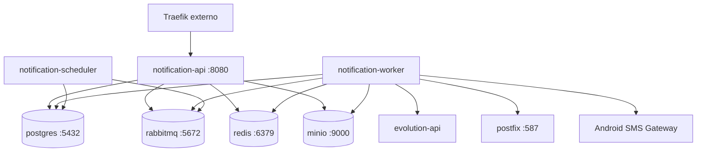

# Topología Docker de referencia

No se incluye un Compose listo para producción porque aún deben fijarse imágenes, secretos, nombres reales de redes, dominios, rutas de datos y límites de recursos. La siguiente topología define qué servicios y conexiones debe contener el Compose.

## Variables de entorno — nombres, no valores

Implementadas en el código actual (ver [.env.example](../../.env.example)):

- `ASPNETCORE_ENVIRONMENT` (API) / `DOTNET_ENVIRONMENT` (Worker, Scheduler)
- `ConnectionStrings__DefaultConnection`: **única** convención para PostgreSQL en Api, Worker y Scheduler (`ConnectionStrings:DefaultConnection` en configuración jerárquica). Se valida al arrancar; sin ella el host no inicia.
- `OpenApi__Enabled`: expone OpenAPI/Swagger UI fuera de Development (por defecto `false`).

Variables de despliegue (las lee el Compose para las labels de Traefik, no la aplicación; PD-06 aprobada):

- `NOTIFICATIONS_API_HOST`, `NOTIFICATIONS_ADMIN_HOST`, `NOTIFICATIONS_WEBHOOKS_HOST`.

Previstas para fases posteriores (no implementadas):

- `RabbitMQ__Host`, `RabbitMQ__Username`, `RabbitMQ__Password`
- `Redis__ConnectionString`
- `Storage__Endpoint`, `Storage__Bucket`, `Storage__AccessKey`, `Storage__SecretKey`
- `Secrets__KeyReference`
- `Authentication__Issuer`, `Authentication__Audience`
- `PublicUrls__Api`, `PublicUrls__Webhook`
- `Providers__Evolution__BaseUrl` (si es configuración de infraestructura global)
- `OTEL_EXPORTER_OTLP_ENDPOINT`

Credenciales se inyectan desde secretos de Docker/Portainer o secret manager. No incluir valores reales en `.env.example`.

## Requisitos operativos por servicio

| Servicio   | Persistencia                     | Exposición                                 |
| ---------- | -------------------------------- | ------------------------------------------ |
| API        | No requiere volumen              | Solo Traefik                               |
| Worker     | Logs/telemetría externa          | Ninguna                                    |
| Scheduler  | Estado durable en PostgreSQL     | Ninguna                                    |
| PostgreSQL | Volumen + backups                | Solo red interna                           |
| RabbitMQ   | Volumen + definiciones           | Solo red interna                           |
| Redis      | Opcional según datos             | Solo red interna                           |
| MinIO      | Volumen + backup de objetos      | Solo red interna                           |
| Evolution  | Volumen de sesión                | Red de proveedores; UI/endpoint no público |
| Postfix    | Configuración/colas según diseño | SMTP restringido; no abrir relay público   |

## Notas

- En producción fijar imágenes por versión/digest, no `latest`.
- Una imagen por host ([PD-07](../history/PENDING-DECISIONS.md#pd-07-estrategia-de-imágenes-docker), aprobada): `notification-api`, `notification-worker` y `notification-scheduler`, cada una con su Dockerfile y su servicio en el Compose.
- No ejecutar migraciones EF automáticamente en cada réplica.
- Healthcheck de API: `GET /health/live` (liveness, solo el proceso) y `GET /health/ready` (readiness; incluirá cada dependencia cuando tenga una comprobación real). Worker/Scheduler: `GET /health/live` y `GET /health/ready` por HTTP interno, sin puerto publicado ni ruta en Traefik (TP-05, aprobado; implementación pendiente; [health-checks.md](health-checks.md)).
- Proteger consola de RabbitMQ y MinIO; no exponerlas públicamente.
