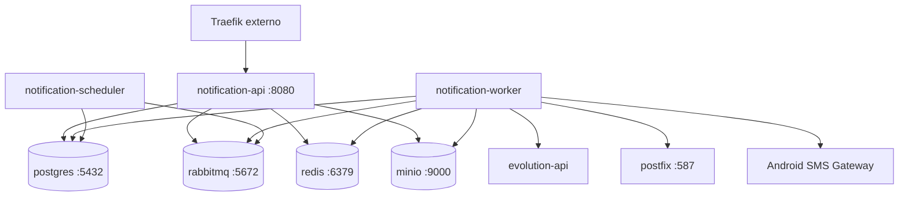

# Topología Docker de referencia

No se incluye un Compose listo para producción porque aún deben fijarse imágenes, secretos, nombres reales de redes, dominios, rutas de datos y límites de recursos. La siguiente topología define qué servicios y conexiones debe contener el Compose.

## Variables de entorno — nombres, no valores

- `ASPNETCORE_ENVIRONMENT`
- `ConnectionStrings__DefaultConnection`
- `RabbitMQ__Host`, `RabbitMQ__Username`, `RabbitMQ__Password`
- `Redis__ConnectionString`
- `Storage__Endpoint`, `Storage__Bucket`, `Storage__AccessKey`, `Storage__SecretKey`
- `Secrets__KeyReference`
- `Authentication__Issuer`, `Authentication__Audience`
- `PublicUrls__Api`, `PublicUrls__Webhook`
- `Providers__Evolution__BaseUrl` (si es configuración de infraestructura global)
- `OTEL_EXPORTER_OTLP_ENDPOINT`

Credenciales se inyectan desde secretos de Docker/Portainer o secret manager. No incluir valores reales en `.env.example`.

## Requisitos operativos por servicio

| Servicio | Persistencia | Exposición |
|---|---|---|
| API | No requiere volumen | Solo Traefik |
| Worker | Logs/telemetría externa | Ninguna |
| Scheduler | Estado durable en PostgreSQL | Ninguna |
| PostgreSQL | Volumen + backups | Solo red interna |
| RabbitMQ | Volumen + definiciones | Solo red interna |
| Redis | Opcional según datos | Solo red interna |
| MinIO | Volumen + backup de objetos | Solo red interna |
| Evolution | Volumen de sesión | Red de proveedores; UI/endpoint no público |
| Postfix | Configuración/colas según diseño | SMTP restringido; no abrir relay público |

## Notas

- En producción fijar imágenes por versión/digest, no `latest`.
- API y Worker pueden compartir la misma imagen con entrypoints distintos o imágenes separadas; elegir una estrategia de build.
- No ejecutar migraciones EF automáticamente en cada réplica.
- Healthcheck de API debe distinguir liveness y readiness.
- Proteger consola de RabbitMQ y MinIO; no exponerlas públicamente.
