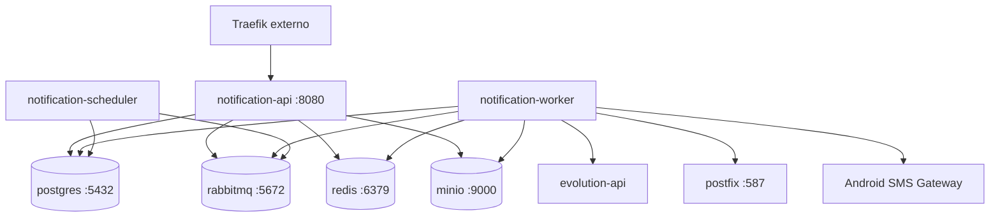

# Topología Docker

El repositorio incluye Compose en tres capas:

- `compose.yaml`: base común de servicios, redes y volúmenes.
- `compose.dev.yaml`: desarrollo local (build de imágenes y puertos en `127.0.0.1`).
- `compose.prod.yaml`: producción (imágenes GHCR y red externa de Traefik).



## Variables de entorno — nombres, no valores

Implementadas en el código actual (ver [.env.example](../../.env.example)):

- `ASPNETCORE_ENVIRONMENT` (API) / `DOTNET_ENVIRONMENT` (Worker, Scheduler)
- `ConnectionStrings__DefaultConnection`: **única** convención para PostgreSQL en Api, Worker y Scheduler (`ConnectionStrings:DefaultConnection` en configuración jerárquica). Se valida al arrancar; sin ella el host no inicia.
- `OpenApi__Enabled`: expone OpenAPI/Swagger UI fuera de Development (por defecto `false`).

Variables de despliegue (las lee el Compose para las labels de Traefik, no la aplicación; PD-06 aprobada):

- `NOTIFICATIONS_API_HOST`, `NOTIFICATIONS_ADMIN_HOST`, `NOTIFICATIONS_WEBHOOKS_HOST`.
- `TRAEFIK_NETWORK_NAME`.

Variables de Compose para infraestructura e imágenes:

- `POSTGRES_IMAGE`, `RABBITMQ_IMAGE`, `REDIS_IMAGE`, `MINIO_IMAGE`
- `NOTIFICATION_API_IMAGE`, `NOTIFICATION_WORKER_IMAGE`, `NOTIFICATION_SCHEDULER_IMAGE`
- `POSTGRES_DB`, `POSTGRES_USER`, `POSTGRES_PASSWORD`
- `RABBITMQ_DEFAULT_USER`, `RABBITMQ_DEFAULT_PASS`, `RABBITMQ_DEFAULT_VHOST`
- `REDIS_PASSWORD`
- `MINIO_ROOT_USER`, `MINIO_ROOT_PASSWORD`
- `NOTIFICATION_INTERNAL_NETWORK`, `NOTIFICATION_PROVIDERS_NETWORK`
- `POSTGRES_VOLUME_NAME`, `RABBITMQ_VOLUME_NAME`, `REDIS_VOLUME_NAME`, `MINIO_VOLUME_NAME`

Credenciales se inyectan desde secretos de Docker/Portainer o secret manager. No incluir valores reales en `.env.example`.

## Requisitos operativos por servicio

| Servicio   | Persistencia                     | Exposición                                     |
| ---------- | -------------------------------- | ---------------------------------------------- |
| API        | No requiere volumen              | Traefik en producción; localhost en desarrollo |
| Worker     | Logs/telemetría externa          | Ninguna                                        |
| Scheduler  | Estado durable en PostgreSQL     | Ninguna                                        |
| PostgreSQL | Volumen + backups                | Solo red interna                               |
| RabbitMQ   | Volumen + definiciones           | Solo red interna                               |
| Redis      | Opcional según datos             | Solo red interna                               |
| MinIO      | Volumen + backup de objetos      | Solo red interna                               |
| Evolution  | Volumen de sesión                | Red de proveedores; UI/endpoint no público     |
| Postfix    | Configuración/colas según diseño | SMTP restringido; no abrir relay público       |

## Notas

- En producción fijar imágenes por versión/digest, no `latest`.
- Una imagen por host ([PD-07](../history/PENDING-DECISIONS.md#pd-07-estrategia-de-imágenes-docker), aprobada): `notification-api`, `notification-worker` y `notification-scheduler`, cada una con su Dockerfile y su servicio en el Compose.
- No ejecutar migraciones EF automáticamente en cada réplica.
- `compose.yaml` define healthchecks reales para PostgreSQL, RabbitMQ, Redis y MinIO.
- Healthcheck HTTP de API se mantiene como endpoint aplicable para sondas externas (`/health/live` y `/health/ready`).
- Worker/Scheduler: `GET /health/live` y `GET /health/ready` por HTTP interno siguen pendientes de implementación (TP-05, [health-checks.md](health-checks.md)).
- Proteger consola de RabbitMQ y MinIO; no exponerlas públicamente.

## Comandos base

```bash
docker compose -f compose.yaml config
docker compose -f compose.yaml -f compose.dev.yaml config
docker compose -f compose.yaml -f compose.prod.yaml config

docker compose -f compose.yaml -f compose.dev.yaml up -d
docker compose -f compose.yaml -f compose.dev.yaml up -d postgres rabbitmq redis minio
docker compose -f compose.yaml -f compose.dev.yaml down
```
