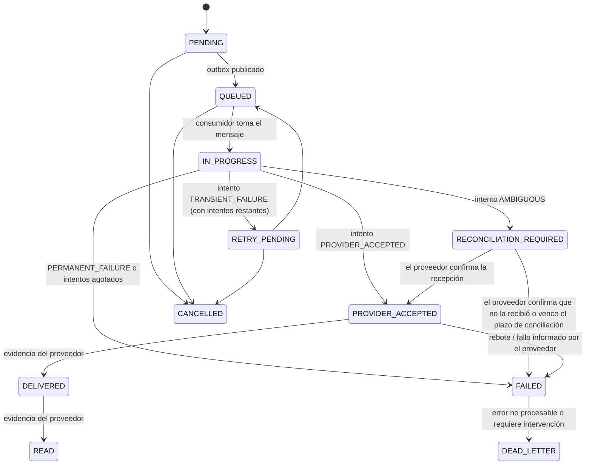

# Decisiones pendientes de aprobación

**Estado del documento:** propuestas. **Nada de este documento es una decisión aprobada** ni modifica los ADR ni `DECISIONS-v1.5.md`. Cada punto se resuelve cuando el responsable del producto lo aprueba; entonces se actualizan el documento fuente afectado (ADR, ERD, OpenAPI, etc.) y este registro.

Origen: saneamiento del repositorio del 2026-11-15 ([repository-sanitization-report.md](../operations/repository-sanitization-report.md)).

| ID | Tema | Estado | Bloquea Fase 2 |
|---|---|---|---|
| [PD-01](#pd-01-nomenclatura-y-alcance-de-roles) | Nomenclatura y alcance de roles | Pendiente | Sí (seed de roles, `membership_roles`, almacenamiento de `super_admin`) |
| [PD-02](#pd-02-máquina-de-estados-de-notificación-entrega-e-intento) | Máquina de estados | Pendiente | Sí (columnas/enum de estado y restricciones) |
| [PD-03](#pd-03-puertos-de-proveedores) | Puertos de proveedores | Pendiente | No (afecta fases de adaptadores) |
| [PD-04](#pd-04-uso-de-400-409-y-422) | Uso de 400 / 409 / 422 | Pendiente | No (afecta API y OpenAPI) |
| [PD-05](#pd-05-timezone_override-de-aplicación) | `timezone_override` de aplicación | Pendiente | Sí (columna en `applications`) |
| [PD-06](#pd-06-subdominios-y-dns) | Subdominios y DNS | Pendiente (datos de infraestructura) | No |
| [PD-07](#pd-07-estrategia-de-imágenes-docker) | Estrategia de imágenes Docker | Pendiente | No |
| [PD-08](#pd-08-respuestas-409-y-429-ausentes-en-openapiyaml) | Respuestas 409/429 ausentes en `openapi.yaml` | Pendiente | No |

Resuelto durante el saneamiento (no requiere decisión adicional): **cadena de conexión** → `ConnectionStrings:DefaultConnection` / `ConnectionStrings__DefaultConnection`, la convención que ya documentaba [compose-topology.md](../deployment/compose-topology.md) y la preferencia indicada por el usuario.

---

## PD-01. Nomenclatura y alcance de roles

### Problema

| Fuente | Roles |
|---|---|
| [ADR-0011](../adr/0011-admin-identity.md) (estado: Aceptado; "roles iniciales sugeridos") | `super_admin`, `organization_admin`, `application_admin`, `operator`, `viewer` |
| [rbac-matrix.md](../security/rbac-matrix.md) | `super_admin`, `org_admin`, `operator`, `viewer` (+ API Key de aplicación) |

Además, el [ERD](../data/erd.md) no define dónde se almacena `super_admin`: `roles.organization_id` admite `NULL` (rol global), pero la única asignación de roles es `membership_roles`, que depende de una membresía de organización. La matriz RBAC exige que `super_admin` "no debe ser asignado como rol ordinario de organización".

### Análisis

1. **`org_admin` frente a `organization_admin`:** mismo concepto (administrador de una organización). La diferencia es solo de nombre. Tiene prioridad el ADR.
2. **`application_admin`:** solo aparece en el ADR. Un rol limitado a ciertas aplicaciones requiere asignar roles con ámbito de aplicación, y `membership_roles (membership_id, role_id)` no tiene `application_id`. Adoptarlo implica cambiar el modelo.
3. **Alcance según la matriz RBAC** (base para cualquier alternativa):

| Rol | Ámbito | Resumen de permisos |
|---|---|---|
| `super_admin` | Plataforma | Operaciones globales (organizaciones, catálogo de proveedores, límites globales), siempre auditadas. No envía notificaciones por defecto |
| `organization_admin` / `org_admin` | Una organización (vía membresía) | Miembros, aplicaciones, API Keys, proveedores y credenciales, WhatsApp, remitentes, plantillas, campañas, dashboard y auditoría de su organización |
| `operator` | Una organización | Operación según permisos concedidos (conectar WhatsApp, asignar remitentes, plantillas, enviar, cancelar/reintentar) |
| `viewer` | Una organización | Solo lectura (notificaciones, campañas, dashboard) |
| API Key | Una aplicación | Scopes propios; no hereda permisos humanos |

### Alternativas

- **A.** Adoptar los nombres del ADR, **sin** `application_admin` en v1. Ámbito de organización para todos los roles de membresía. Restringir por aplicación mediante permisos granulares cuando haga falta.
- **B.** Adoptar los nombres del ADR **con** `application_admin`, añadiendo `membership_roles.application_id` (nullable) e índices o validaciones de pertenencia a la misma organización.
- **C.** Adoptar los nombres de la matriz RBAC (`org_admin`) y actualizar el ADR.

### Recomendación

**A**, con `organization_admin` como nombre canónico: respeta la prioridad del ADR y evita un cambio de modelo que nadie ha pedido (YAGNI). El modelo queda abierto para añadir B más adelante. Para `super_admin`, guardarlo **fuera** de las membresías: una tabla `platform_role_assignments (user_id, role)` o un indicador auditado en `users`. Decidir cuál antes de la Fase 2.

### Impacto en la Fase 2

Define los datos iniciales de `roles` y `permissions`, si `membership_roles` lleva `application_id` y cómo se persiste `super_admin`. **Bloqueante para las migraciones de identidad.**

---

## PD-02. Máquina de estados de notificación, entrega e intento

### Problema

- [rabbitmq-outbox.md](../messaging/rabbitmq-outbox.md) define un solo flujo: `ACCEPTED → QUEUED → PROCESSING → SENT → DELIVERED → READ`, con las ramas `RETRY_PENDING`, `FAILED`, `DEAD_LETTER` y `CANCELLED`.
- [provider-contracts-v1.5.md](../providers/provider-contracts-v1.5.md) añade "resultado ambiguo → `UNKNOWN/RECONCILIATION_REQUIRED`", que no aparece en el flujo anterior.
- El [ERD](../data/erd.md) tiene `status` en `notifications` y en `notification_deliveries`, y `result_code` en `notification_attempts`, pero no define el dominio de valores de cada uno.
- En [openapi.yaml](../api/openapi.yaml), `NotificationStatus.status` es un `string` libre. Solo `AcceptedNotification` enumera `ACCEPTED` y `QUEUED`.

### Propuesta: tres niveles separados

**1. Intento (`notification_attempts.result_code`): inmutable, una fila por llamada al proveedor.**

| Resultado | Significado |
|---|---|
| `PROVIDER_ACCEPTED` | El proveedor aceptó la solicitud (HTTP 2xx de Evolution, respuesta SMTP 250, `id` de SMSGate) |
| `TRANSIENT_FAILURE` | Error recuperable (timeout **antes** de enviar, 5xx, 429 del proveedor) |
| `PERMANENT_FAILURE` | Error no recuperable (destinatario inválido, credencial inválida) |
| `AMBIGUOUS` | No se sabe si el proveedor recibió el mensaje (timeout o caída **después** de enviar) |

**2. Entrega (`notification_deliveries.status`): ciclo de vida técnico frente al proveedor.**

- `RECONCILIATION_REQUIRED` **no** se reintenta automáticamente ([ADR-0012](../adr/0012-delivery-semantics.md)). Un reenvío manual requiere autorización y queda auditado.
- `DELIVERED` y `READ` solo se registran con evidencia del proveedor, según sus capacidades declaradas:

| Proveedor | Aceptación | Entrega final | Lectura |
|---|---|---|---|
| Evolution v2.3.7 | Sí (`data.key.id`) | Posible por webhook, **por validar** | Posible por webhook, **por validar** |
| SMTP (Postfix/externo) | Sí (`SMTP_ACCEPTED`) | No (solo rebotes/DSN si se configuran) | No |
| SMSGate | Sí (`id`) | Depende de dispositivo y operador, **por validar** | No |

**3. Notificación (`notifications.status`): estado público resumido para la API.** En v1 hay una entrega por notificación ([ERD](../data/erd.md)), así que el estado público se **deriva** de la entrega:

| Entrega | Notificación (API) |
|---|---|
| `PENDING` | `ACCEPTED` (o `SCHEDULED` si tiene `scheduledAt` futuro) |
| `QUEUED`, `RETRY_PENDING` | `QUEUED` |
| `IN_PROGRESS`, `RECONCILIATION_REQUIRED` | `PROCESSING` |
| `PROVIDER_ACCEPTED` | `SENT` |
| `DELIVERED` / `READ` | `DELIVERED` / `READ` |
| `FAILED`, `DEAD_LETTER` | `FAILED` |
| `CANCELLED` | `CANCELLED` |

### Alternativas

- **A.** Tres niveles como arriba, con `RECONCILIATION_REQUIRED` visible en el timeline de eventos pero no como estado público.
- **B.** Igual que A, pero exponiendo `UNKNOWN` como estado público de la notificación (más transparente; requiere cambiar OpenAPI y la documentación de clientes).
- **C.** Un único campo de estado compartido por notificación y entrega, con el flujo actual de `rabbitmq-outbox.md` más `UNKNOWN` (más simple, pero mezcla la semántica técnica con la pública).

### Recomendación

**A.** Separa responsabilidades sin sobreingeniería, cumple ADR-0012 y no promete entregas que el proveedor no confirma. La alternativa B es razonable si el producto prefiere transparencia total. **Nombres finales, valores y plazo de conciliación: pendientes de aprobación.**

### Impacto en la Fase 2

Define tipos y restricciones `CHECK` de `notifications.status`, `notification_deliveries.status`, `notification_attempts.result_code` y `notification_status_history`. **Bloqueante para las migraciones de notificaciones.**

---

## PD-03. Puertos de proveedores

### Problema

[hexagonal.md](../architecture/hexagonal.md) define un puerto genérico `INotificationProvider` (`SendAsync`, `TestConnectionAsync`, `GetHealthAsync`). [ADR-0004](../adr/0004-whatsapp-adapters.md) y [provider-adapters.md](../providers/provider-adapters.md) proponen `IWhatsAppProvider` + `IWhatsAppConnectionManager`. El propio `hexagonal.md` advierte que no se debe obligar a Email/SMS a implementar operaciones de QR.

### Propuesta (solo contratos; los adaptadores no se implementan en esta fase)

Ubicación: `NotificationService.Application/Abstractions/Providers/`. Tipos neutrales, sin DTOs de proveedor.

| Puerto | Responsabilidad | Implementación inicial |
|---|---|---|
| `IWhatsAppProvider` | `SendTextAsync`, `SendMediaAsync` → `ProviderSendResult` | Evolution |
| `IWhatsAppConnectionManager` | Crear/eliminar instancia, obtener QR efímero, consultar estado, desconectar/reconectar | Evolution |
| `IEmailProvider` | `SendAsync(EmailMessage)` → `ProviderSendResult` | SMTP (Postfix y SMTP externo comparten el adaptador; distinto perfil) |
| `ISmsProvider` | `SendAsync(SmsMessage)` → `ProviderSendResult` | SMSGate |
| `IProviderConnectionTester` (opcional) | `TestConnectionAsync`, `GetHealthAsync` | Solo los adaptadores que lo soporten |
| `IProviderWebhookVerifier` | Verificar autenticidad (firma/token) de un webhook para una cuenta | Por proveedor, tras cerrar su contrato |
| `IProviderWebhookTranslator` | Convertir el payload validado en eventos internos canónicos | Por proveedor |

Tipos compartidos: `ProviderSendResult { Outcome (PROVIDER_ACCEPTED | TRANSIENT_FAILURE | PERMANENT_FAILURE | AMBIGUOUS), ProviderMessageId?, ErrorCode?, RetryAfter? }` (alineado con PD-02) y `ProviderCapabilities` (texto, media, eventos de entrega/lectura, conexión por QR).

La selección de adaptador por `provider_definitions.adapter_key` la hace un resolvedor por canal, como describe `hexagonal.md`. La política de selección de cuenta y remitente pertenece a Application.

### Alternativas

- **A.** Puertos especializados por canal más interfaces opcionales de capacidad (propuesta).
- **B.** Mantener `INotificationProvider` universal (obliga a implementar operaciones no soportadas o a lanzar `NotSupportedException`).
- **C.** `INotificationProvider` mínimo (`SendAsync(envelope)`) más interfaces de capacidad. Es más genérico, pero el envelope debe modelar a la vez texto, media, asunto y adjuntos de los tres canales.

### Recomendación

**A.** Es coherente con ADR-0004 (que cita `IWhatsAppProvider` como ejemplo) y con la advertencia de `hexagonal.md`. Si se aprueba, se actualiza la sección "Contrato de proveedor" de `hexagonal.md`.

### Impacto en la Fase 2

Ninguno directo: afecta a las fases de adaptadores. Los contratos deben fijarse antes de implementar el primer proveedor.

---

## PD-04. Uso de 400, 409 y 422

### Problema

[api-design.md](../api/api-design.md) lista `422` "si se adopta distinto de `400` para validación semántica". Los criterios de aceptación exigen "errores de negocio estables" (remitente desconectado, sin remitente predeterminado). `openapi.yaml` no declara `422` en ninguna operación.

### Alternativas (todas con RFC 9457 y `code` estable)

| Código | A. Sin 422 | B. Con 422 (propuesta) |
|---|---|---|
| `400` | Esquema, formato **y** reglas de negocio | Solo esquema/sintaxis/formato (campo requerido, tipo, longitud, enum) |
| `409` | Conflicto de estado o de idempotencia | Igual: conflicto con el estado actual del recurso (cancelar algo ya despachado) o `Idempotency-Key` con hash distinto |
| `422` | No se usa | Solicitud bien formada que viola una regla de negocio (sin remitente predeterminado válido, remitente desconectado, variables de plantilla incompletas, límite de aplicación mayor que el de la organización) |

### Recomendación

**B.** Permite al cliente distinguir "corrige el formato" de "la operación no es posible con el estado de negocio actual", y `api-design.md` ya lo anticipa. En ambas alternativas el cliente debe actuar sobre `code`, no solo sobre el código HTTP. Si se aprueba: actualizar `api-design.md`, añadir `422` a las operaciones afectadas de `openapi.yaml` y crear un catálogo de `code`. **No se ha modificado OpenAPI.**

### Impacto en la Fase 2

Ninguno en persistencia. Debe resolverse antes de implementar el primer endpoint funcional.

---

## PD-05. `timezone_override` de aplicación

### Reglas aprobadas (no cambian)

Zona horaria IANA obligatoria por organización (predeterminada `America/Lima`). Las aplicaciones la heredan "salvo configuración explícita permitida". Instantes en UTC. La cuota diaria de WhatsApp es **agregada por organización** y se reinicia a las 00:00 de la zona horaria de la organización ([DECISIONS-v1.5.md](DECISIONS-v1.5.md) §8-9).

### Problema

El [ERD](../data/erd.md) incluye `applications.timezone_override` nullable "solo si la política de producto lo habilita", pero esa política no está definida. También falta precisar dónde se interpreta la hora local: la API pública exige fechas RFC 3339 en UTC ([api-design.md](../api/api-design.md)), mientras los criterios de aceptación piden "convertir hora local a UTC y conservar zona horaria/valor local".

### Alternativas

- **A.** Sin override en v1: no crear la columna (o crearla siempre `NULL` y sin API). Todo cálculo usa la zona de la organización.
- **B.** Override limitado: afecta solo a la interpretación de horas locales de programación (scheduling/campañas) y a la presentación de esa aplicación. **Nunca** a la cuota agregada de la organización, que sigue usando la zona de la organización. Los límites diarios por aplicación usarían la zona de la organización para no tener dos "días" distintos.
- **C.** Override completo, incluidas las ventanas de límites por aplicación (riesgo de inconsistencias con la cuota agregada).

### Recomendación

**A para v1**, documentando B como la extensión permitida. Si el producto necesita B desde el inicio, la columna debe existir en la Fase 2 y su uso debe limitarse a la interpretación de horas locales, nunca a la cuota.

### Impacto en la Fase 2

Determina si se crea `applications.timezone_override`. **Bloqueante menor para la migración de `applications`.**

---

## PD-06. Subdominios y DNS

Las propuestas de [docker.md](../deployment/docker.md) (`api-notifications.<dominio>`…) y [environment-decisions.md](../deployment/environment-decisions.md) (`notifications-api.<dominio>`…) diferían. Ninguna está confirmada. La documentación se unificó con variables (`NOTIFICATIONS_API_HOST`, `NOTIFICATIONS_ADMIN_HOST`, `NOTIFICATIONS_WEBHOOKS_HOST`). **Pendiente:** nombres DNS reales, dominio raíz y si los webhooks usan un subdominio propio. `openapi.yaml` conserva su URL de ejemplo (`notifications-api.example.com`), marcada como propuesta.

---

## PD-07. Estrategia de imágenes Docker

[compose-topology.md](../deployment/compose-topology.md) deja abierto si API y Worker comparten imagen. Se han **preparado** (sin decidir) Dockerfiles independientes por host: `src/NotificationService.{Api,Worker,Scheduler}/Dockerfile`. **Recomendación:** una imagen por host. Cada una lleva solo su runtime (`aspnet` para la API, `runtime` para Worker y Scheduler), escala por separado y tiene una superficie menor. **Pendiente de aprobación** junto con el nombrado en GHCR.

---

## PD-08. Respuestas 409 y 429 ausentes en `openapi.yaml`

[api-design.md](../api/api-design.md) y los [criterios de aceptación](../acceptance/criteria.md) exigen `409` (idempotencia o estado) y `429` (cuota/rate limit con `Retry-After`). Las 93 operaciones de `openapi.yaml` solo declaran `400`, `401`, `403` y `404`. **Recomendación:** antes del primer endpoint funcional, añadir al contrato `409` y `429` (y `422` si se aprueba PD-04) en las operaciones que corresponda, mediante una revisión del contrato. **No se ha modificado OpenAPI.**
